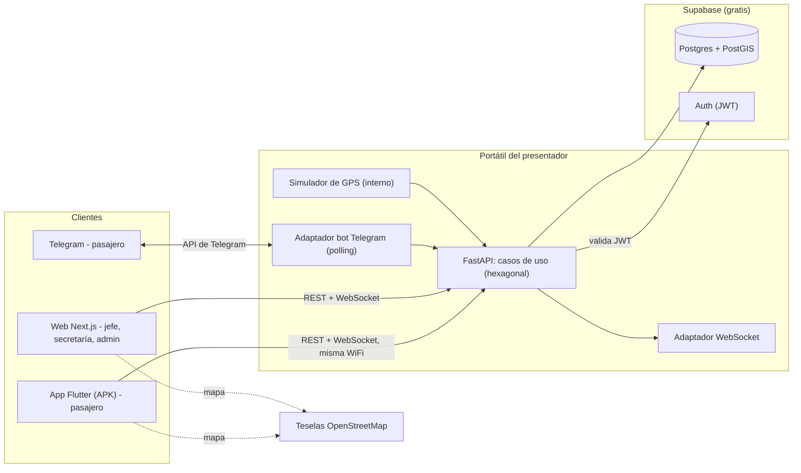

# Plan del prototipo para presentar en clase

## 1. Idea en una frase

Un sistema completo que **parece real** (mapa de Manizales, busetas moviéndose, ETA, alertas, 4 roles) pero cuyos datos de ubicación son **simulados por un generador interno**, listo para que el día que exista un convenio solo se conecte una fuente GPS real sin tocar el resto.

## 2. Qué se muestra y en qué dispositivo

| Quién | Dispositivo | Qué ve |
|---|---|---|
| **Pasajero** | **Celular Android** con la app Flutter (APK) | Mapa con rutas y busetas en vivo, ficha de ruta (Recorrido, Horarios, Frecuencia, En vivo), ETA por parada, búsqueda por hito, planificar viaje, favoritos, avisos |
| **Pasajero** | **Telegram** (en el mismo celular o en otro) | Bot: explica cómo funciona la app, rutas cerca de mí, ¿cuándo llega?, horarios, avisos, "avisarme cuando esté cerca" |
| **Jefe de operaciones** | **PC** (navegador) | Rodamiento con detección de solapamientos, asignar buseta/conductor, avisos de empresa, estadísticas |
| **Secretaría de Movilidad** | **PC** (navegador) | Rutas (registrar/eliminar con control de versión), paraderos, cambios de movilidad |
| **Administrador** | **PC** (navegador) | Usuarios, empresas, parámetros, claves de fuentes GPS y **Panel de demo** (perder señal, desvío, cambiar la hora simulada) |

## 3. Arquitectura (resumen)



Idea clave: **el simulador entra por el mismo caso de uso que usaría un GPS real** (`registrar_posiciones`). Todo lo demás (ETA, alertas, WebSocket, Telegram) es código de producción, no de demo.

## 4. Qué es real y qué es simulado

| Elemento | Estado en el prototipo |
|---|---|
| Lógica de ETA, alertas, rodamiento, roles, control de versión, búsqueda, planificación | **Real** (código funcional) |
| Base de datos, login, WebSockets, bot de Telegram, mapas | **Real** |
| Horarios, frecuencias, laterales 2683 y 2676, hitos | **Reales** (levantamiento de campo) |
| Trazados de rutas | **Calles reales** de Manizales, pero **rutas inventadas** (no oficiales) |
| Paraderos | **Ficticios** (puntos sobre el trazado) |
| Posiciones de busetas | **Simuladas** |
| Conductores, algunos laterales y códigos (p. ej. Socobuses 18) | **Ficticios** |

La interfaz siempre muestra el banner "Datos de ejemplo · no son rutas oficiales".

## 5. Guion de la demostración (≈ 10 minutos)

1. **(1 min) Contexto.** Problema y 4 roles. Aclarar que los GPS son simulados porque aún no hay convenio.
2. **(2 min) Secretaría de Movilidad (PC).** Ver las rutas de la ciudad y a qué empresa está asignada cada una. Registrar un paradero. Publicar un *cambio de movilidad* ("cierre por obras en la carrera 23", ruta El Cable).
3. **(2 min) Jefe de operaciones — Sideral (PC).** Abrir el rodamiento de mañana: el sistema marca un **solapamiento** de la buseta 1520 y bloquea *Publicar*. Corregir el turno → publicar. Publicar un aviso de festivo.
4. **(3 min) Pasajero — app en el celular.**
   - Mapa con busetas amarillas moviéndose (WebSocket).
   - Ver el aviso de cierre publicado hace un momento.
   - Buscar por hito "Catedral" → ficha de ruta → tocar una parada → ETA por GPS.
   - La Enea tiene dos empresas: Socobuses (GPS) y Serviturismo (sin GPS → "estimado por horario").
   - Planificar viaje origen/destino.
5. **(2 min) Telegram.** `/start` → "Rutas cerca de mí" (compartir ubicación) → "¿Cuándo llega?" → "Avisarme cuando esté cerca". Dejar el chat visible y esperar el mensaje cuando la buseta llegue a 300 m.
6. **(1 min) Administrador — Panel de demo (PC).** "Perder señal" a la buseta 2683 o 1544 → en la app pasa a gris "Ubicación no disponible" y el ETA cambia a respaldo por horario. Cambiar la hora simulada (ej. 06:00 vs 22:30) para mostrar horarios y servicios cerrados.
7. **(cierre)** Mostrar los diagramas reducidos (`docs/02-diagramas.md`) y qué falta para producción.

## 6. Plan B (si algo falla en clase)

| Falla | Qué hacer |
|---|---|
| No hay WiFi o el celular no conecta | Hotspot del celular al portátil, o `cloudflared` (túnel gratuito, ver `docs/04`). Último recurso: demo del pasajero en el navegador del PC (`flutter run -d chrome` ya compilado) |
| Supabase pausado o sin internet | Revisar el proyecto el día anterior (los gratuitos se pausan por inactividad). Llevar el video grabado de la demo |
| Teselas de OpenStreetMap lentas | Variable `MAP_TILE_URL`: apuntar a otro proveedor gratuito; el mapa se carga antes de empezar |
| Bot de Telegram no responde | Ver `TELEGRAM_BOT_TOKEN`; mostrar capturas/video del flujo |
| Se detiene el simulador | Panel de demo → "Reiniciar simulación" |

**Antes de entrar a clase:** probar el recorrido completo una vez, dejar 2 celulares con el APK, grabar un video de respaldo de 2 minutos, tener las cuentas demo abiertas en pestañas.

## 7. Estructura del repositorio (respuesta a "¿varias carpetas?")

**Sí, pero en un solo repositorio (monorepo) con tres proyectos independientes.** Razones: los agentes comparten `CLAUDE.md` y `docs/`, el contrato de API vive en un solo lugar y un `git clone` basta para la demo.

```text
busetasapp/
  CLAUDE.md                  # reglas para todos los agentes
  README.md
  .claude/
    agents/                  # backend-dev, web-admin-dev, mobile-dev
    skills/                  # 4 skills
  contrato/openapi.json      # lo genera el backend (FastAPI)
  docs/                      # plan, alcance, diagramas, contrato, guía, referencia/
  backend/                   # Python + FastAPI + bot + simulador   (proyecto 1)
  web-admin/                 # Next.js: jefe, secretaría, admin      (proyecto 2)
  mobile/                    # Flutter: pasajero                      (proyecto 3)
```

El bot de Telegram **no** es un cuarto proyecto: vive en `backend/src/adaptadores_externos/` y llama a los mismos casos de uso (como indica la presentación).

## 8. Hoja de ruta por agente

| Hito | backend-dev | web-admin-dev | mobile-dev | Entregable que se verifica |
|---|---|---|---|---|
| **H0** Cimientos | Proyecto FastAPI, esquema recortado en Supabase, semillas con trazados reales, `contrato/openapi.json`, `/salud` | Proyecto Next.js, login con Supabase, layout por rol | Proyecto Flutter, tema, navegación, pantalla de ajustes de servidor | `GET /salud` ok; datos visibles en Supabase; tres apps abren |
| **H1** Consulta pública | Rutas cercanas, detalle, horarios, frecuencias, búsqueda por texto y hito, avisos | — | Mapa, buscar, ficha de ruta (Recorrido/Horarios/Frecuencia) | Se ve el mapa con rutas |
| **H2** Tiempo real | Simulador, ingesta, WebSocket, ETA con respaldo, panel de demo | Panel de demo (admin) | En vivo + ETA + estado sin señal | Busetas se mueven; "perder señal" funciona |
| **H3** Gestión | Rodamiento y solapamientos, avisos por rol, rutas/paraderos con versión, usuarios, parámetros, claves GPS, estadísticas | Pantallas de jefe, Secretaría y admin | Avisos | Guion pasos 2, 3 y 6 |
| **H4** Pasajero completo | Favoritos, alertas, planificación directa | — | Viajar, Guardados, login, alertas | Guion paso 4 |
| **H5** Telegram | Bot completo y alertas por chat | — | — | Guion paso 5 |
| **H6** Ensayo | Corrección de errores, datos finales | Pulido | APK de release, ensayo en 2 celulares | Guion completo sin fallos 2 veces |

## 9. Preguntas que siguen abiertas (necesito tu respuesta, no bloquean arrancar)

1. **Bot de Telegram:** ¿ya creaste el bot con *BotFather* y tienes el token? Si no, se crea en 2 minutos y es gratis.
2. **Celular:** ¿el celular de la demo es Android? Un APK no se instala en iPhone; si usas iPhone, la alternativa gratuita es abrir la versión web de Flutter en Safari.
3. **Villamaría:** *resuelta*. Entra como cuarta ruta obligatoria, porque las SPECs dejan «Manizales y Villamaría» dentro del alcance. También es el ejemplo del chatbot («¿Qué ruta va a Villamaría?»).
4. **Equipo:** ¿quién presenta cada rol? Si son 4 personas, cada una puede manejar una cuenta (jefe, Secretaría, admin, pasajero) en vivo.
5. **Registro de pasajeros:** ¿basta con correo + contraseña (Supabase Auth) o prefieres un acceso más simple solo para la demo?
