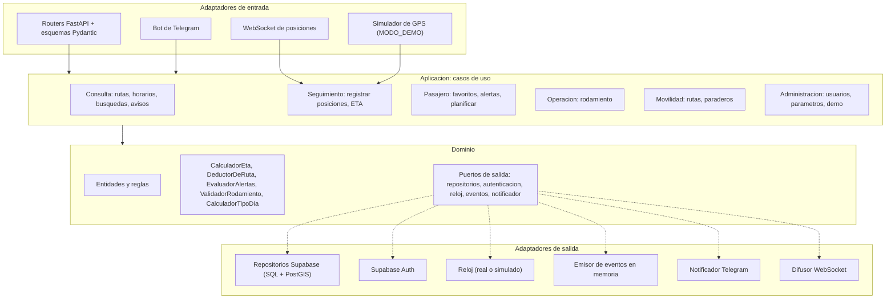
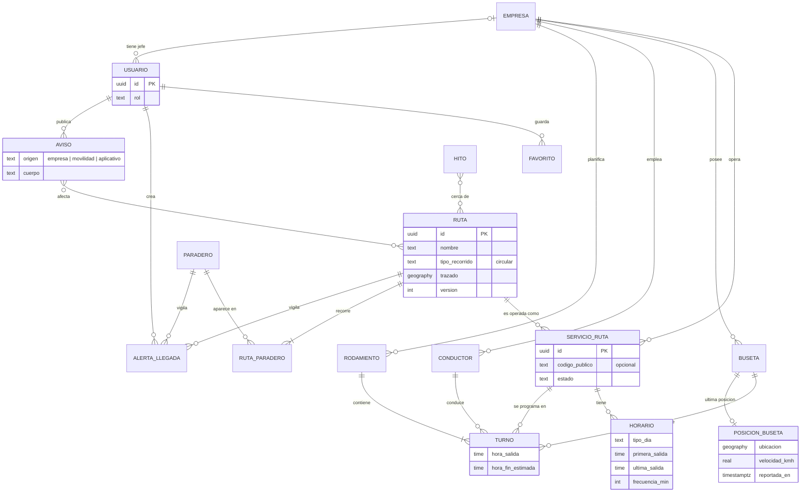
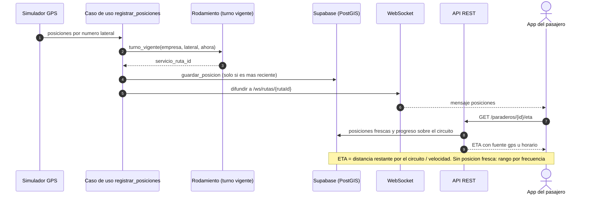
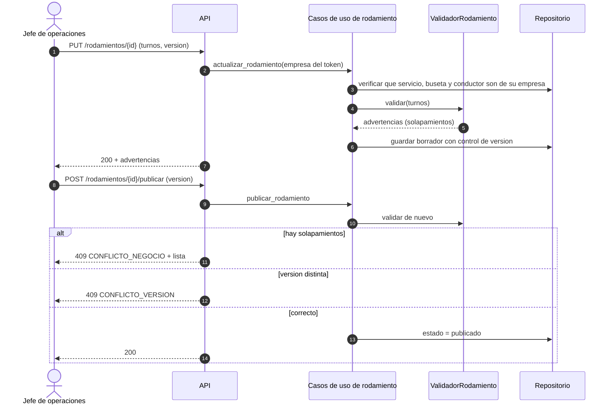
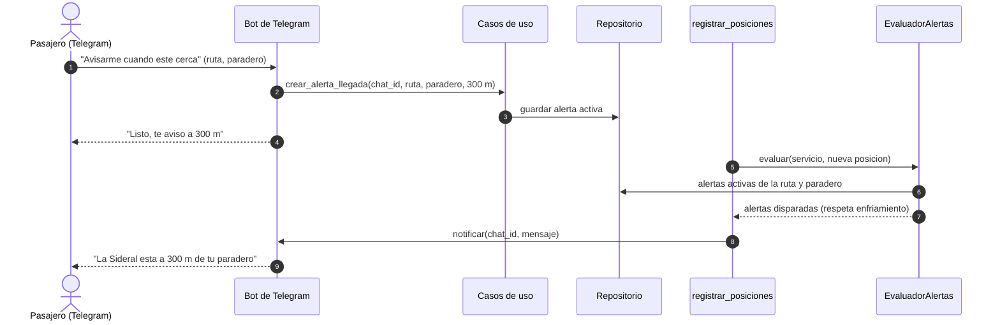

# Diagramas reducidos del prototipo

> Versión pequeña para presentar. La base de datos completa del diseño tiene 28 tablas (`referencia/esquema.sql`); el prototipo usa 22 y este diagrama agrupa lo esencial en 16 entidades. Los diagramas completos están en `referencia/05-actividad-6-datos-api.md`.

## 1. Arquitectura (hexagonal)

## 2. Modelo entidad-relación reducido (16 entidades)

Notas: `HORARIO` representa a las tablas `horario` + `frecuencia` (franjas) de la BD; `RUTA` incluye `ruta_trazado`; `AVISO` incluye `aviso_afecta`. Tablas de apoyo no dibujadas: `credencial_fuente_gps`, `parametro_global`, `evento_uso`.

## 3. Secuencia 1 — Seguimiento y ETA (pasajero, GPS simulado)

## 4. Secuencia 2 — Jefe de operaciones arma y publica el rodamiento

## 5. Secuencia 3 — Alerta de llegada por Telegram

## 6. Flujo de navegación del pasajero

Ver `referencia/03-actividad-4-ux-prototipos.md` §2.1 y la diapositiva "Flujo de Navegación" de la presentación: Mapa → Buscar / Viajar / Guardados / Avisos → Ficha de ruta (Recorrido, Horarios, Frecuencia, En vivo) → ETA de la parada → (Avisarme → sesión).
