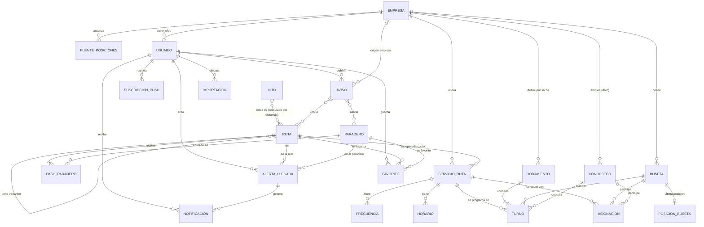
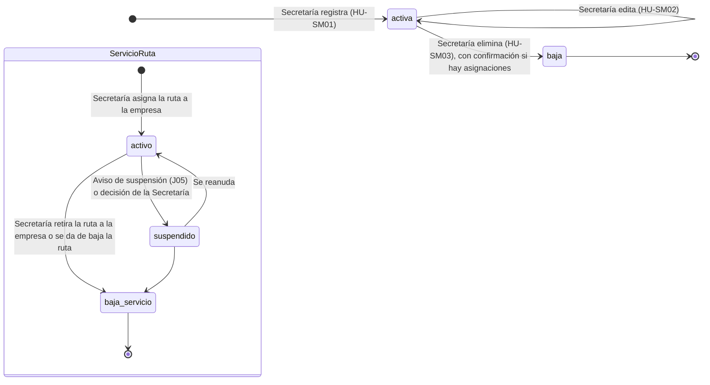
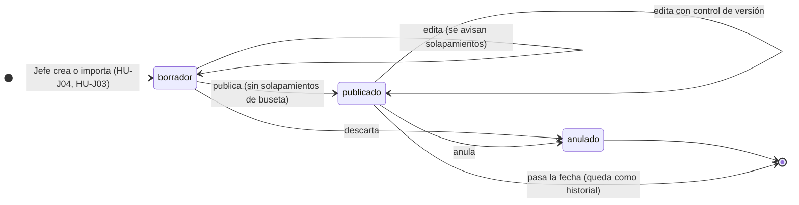
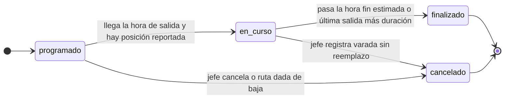
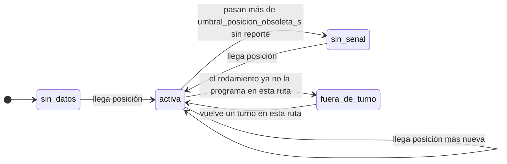
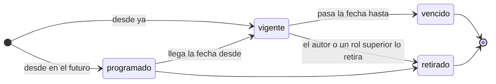
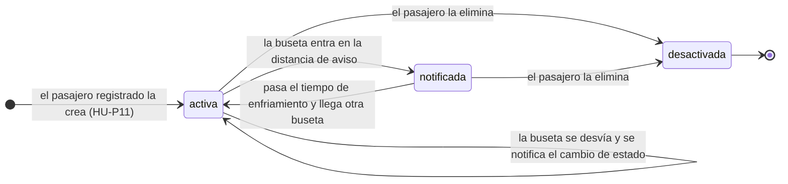
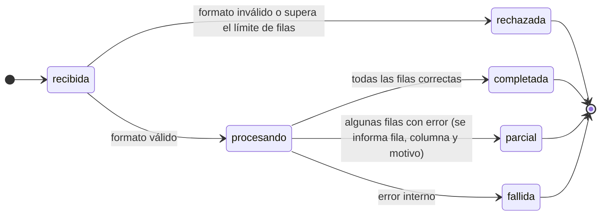
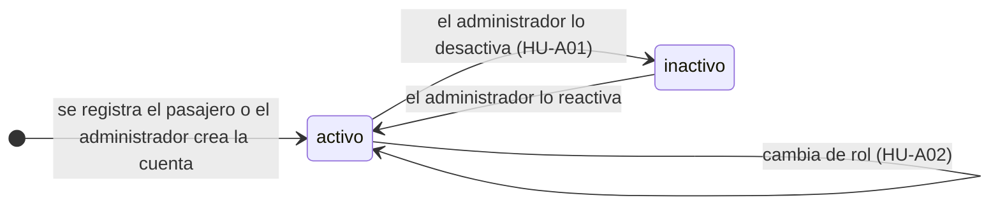

# Actividad 2 — Modelo de dominio de BusetasApp

> **Fuentes:** `contexto-busetasapp.md` (roles, BR-01..BR-08, §8 realidad operativa), historias de usuario (27 HU) y SPEC-001..013 (28 RF, incluye HU-J06 en SPEC-012).
> **Etiquetas:** **[FUENTE]** viene de los documentos. **[PROPUESTO]** es una propuesta de diseño que el equipo debe aprobar. **[SUPUESTO S-xx]** completa información faltante (lista en `00-indice-y-supuestos.md`). Ninguna propuesta se presenta como decisión aprobada.

---

## 1. Entidades del dominio

### 1.1 Catálogo de la red (lo alimenta la Secretaría de Movilidad, BR-04 y BR-08)

| Entidad | Descripción | Origen |
|---|---|---|
| **Empresa** | Empresa de busetas (Socobuses, Sideral, Serviturismo y otras). La gestiona el administrador (HU-A03). | [FUENTE] contexto §4, HU-A03 |
| **Ruta** | Corredor o recorrido de la red de la ciudad. Tiene nombre, tipo de recorrido (lineal o circular) y trazado por sentido. Puede ser **variante** de otra ruta (ej. Bosques de La Enea sobre La Enea). | [FUENTE] contexto §8.2.1 y §8.2.5; el atributo `tipo_recorrido` es [SUPUESTO S-05] |
| **ServicioRuta** | Ruta operada por una empresa. Lleva el código público (opcional), el código interno (opcional), el horario y la frecuencia de **esa empresa**. Es lo que la Secretaría "impone" a una empresa. | [FUENTE] contexto §8.2.2 y BR-04; la entidad es [PROPUESTO S-03] |
| **Paradero** | Punto físico de parada. Lo gestiona la Secretaría (HU-SM04). | [FUENTE] |
| **PasoParadero** | Posición ordenada de un paradero dentro de una ruta y sentido. | [PROPUESTO] |
| **Hito** | Punto de referencia para buscar: hito urbano, barrio, sector, universidad, hospital o terminal (Catedral, El Cable, Carrera 23, Fundadores). | [FUENTE] SPEC-005, contexto §5 |
| **DiaFestivo** | Fecha que se trata como "domingo y festivo" para horarios. | [SUPUESTO S-14] |

### 1.2 Operación de las empresas (la define el jefe de operaciones, BR-03)

| Entidad | Descripción | Origen |
|---|---|---|
| **Horario** | Para un servicio y un tipo de día: primera salida, última salida y cierre total. | [FUENTE] contexto §8.2.3 |
| **Frecuencia** | Para un servicio, un tipo de día y una franja: minutos mínimo y máximo entre busetas. Admite valor fijo (min = max) o rango. | [FUENTE] contexto §8.2.4, HU-P04 |
| **Buseta** | Vehículo de una empresa. Se identifica por **número lateral** (único en la empresa); la placa es opcional. | [FUENTE] contexto §8 (Serviturismo identifica por número lateral); la placa opcional es [SUPUESTO S-06] |
| **Conductor** | **Dato**, no usuario (BR-06). Solo se guarda nombre y un código interno opcional. | [FUENTE] BR-06; minimización de datos [PROPUESTO] |
| **Asignación** | Vínculo vigente entre un servicio de ruta, una buseta y un conductor habitual. Una buseta puede tener varias (opera varias rutas en el día). | [FUENTE] HU-J01, contexto §8.2.6; cardinalidad [SUPUESTO S-06] |
| **Rodamiento** | Plan de operación de una empresa para una fecha. | [FUENTE] HU-J04 |
| **Turno** | Línea del rodamiento: servicio de ruta, hora de salida, buseta (número lateral) y conductor. | [FUENTE] contexto §8.2.6 |

### 1.3 Seguimiento en vivo

| Entidad | Descripción | Origen |
|---|---|---|
| **PosicionBuseta** | Última posición conocida de una buseta (coordenadas, velocidad, rumbo, instante reportado). Solo se conserva la última. | [PROPUESTO S-01] |
| **FuentePosiciones** | Credencial de una empresa para enviar posiciones. Las empresas ya tienen GPS propio y las SPEC indican que "los suministra la empresa". | [FUENTE] SPEC-001 §15, contexto OPEN-Q-003; mecanismo [SUPUESTO S-01] |
| **Eta** | Estimación calculada, **no se persiste**. Tiene fuente `gps`, `horario` o `no_disponible`. | [FUENTE] HU-P06; fuentes [PROPUESTO] |

### 1.4 Comunicación y personalización

| Entidad | Descripción | Origen |
|---|---|---|
| **Aviso** | Mensaje publicado. Su **origen** determina quién lo publica: `empresa` (jefe, BR-05), `movilidad` (Secretaría, cambios de ciudad) o `aplicativo` (administrador). Puede afectar rutas o paraderos. | [FUENTE] HU-J05, HU-SM05, HU-A05; tabla única [PROPUESTO] |
| **Favorito** | Ruta o paradero guardado por un usuario registrado (BR-02). | [FUENTE] HU-P10 |
| **AlertaLlegada** | Solicitud de aviso cuando una buseta se acerque a un paradero de interés. | [FUENTE] HU-P11 |
| **SuscripcionPush** | Registro del navegador del usuario para recibir notificaciones fuera de la app. | [SUPUESTO S-09] |
| **Notificacion** | Mensaje generado para un usuario (bandeja dentro de la app y/o push). | [SUPUESTO S-09] |

### 1.5 Plataforma

| Entidad | Descripción | Origen |
|---|---|---|
| **Usuario** | Cuenta con un rol: `pasajero`, `jefe_operaciones`, `secretaria_movilidad`, `administrador`. El jefe pertenece a **una** empresa. | [FUENTE] contexto §4; empresa única [SUPUESTO S-11] (OPEN-Q-004) |
| **ParametroGlobal** | Valor configurable por el administrador (HU-A04). | [FUENTE] HU-A04 |
| **EventoUso** | Evento anónimo de consulta, base de las estadísticas del jefe. Sin identificador de usuario. | [FUENTE] HU-J06 / SPEC-012; anonimato [SUPUESTO S-12] |
| **Importacion** | Resultado de una carga de Excel (filas totales, correctas, con error). | [FUENTE] HU-J03 |

---

## 2. Diagrama de entidades conceptuales

### 2.1 Cardinalidades y reglas de integridad

| # | Regla | Cardinalidad / condición | Fuente |
|---|---|---|---|
| RD-01 | Una ruta puede ser operada por **varias empresas**; cada par ruta-empresa es un servicio de ruta distinto con horario y frecuencia propios. | Ruta 1—N ServicioRuta; Empresa 1—N ServicioRuta; único (ruta, empresa) mientras no esté dado de baja | contexto §8.2.2 |
| RD-02 | Una variante tiene como máximo **una** ruta principal. No hay ciclos (una variante no es principal de su propia principal). | Ruta 0..1—N Ruta | contexto §8.2.5 |
| RD-03 | Un código público, si existe, es único dentro de la empresa. Una ruta puede no tener código (Serviturismo). | Opcional | contexto §8.2.1 |
| RD-04 | Un paradero puede estar en muchas rutas; una ruta tiene una secuencia ordenada de pasos por sentido. Las rutas circulares usan el sentido `circular`. | Ruta 1—N PasoParadero N—1 Paradero | contexto §5, §8.1 |
| RD-05 | Solo hay un horario por (servicio, tipo de día). Un servicio sin horario aparece como "información pendiente de actualización". | ServicioRuta 1—0..3 Horario | HU-P03 alt. |
| RD-06 | Las franjas de frecuencia de un (servicio, tipo de día) no se solapan. | ServicioRuta 1—N Frecuencia | contexto §8.2.4 |
| RD-07 | El **número lateral** de una buseta es único dentro de su empresa. | Empresa 1—N Buseta | contexto §8.1 |
| RD-08 | Una buseta puede tener **varias asignaciones y varios turnos en el mismo día**, en rutas distintas, pero **sus turnos no se solapan en el tiempo**. | Buseta 1—N Asignación; 1—N Turno | contexto §8.2.6 |
| RD-09 | Un turno solo puede usar una buseta y un conductor de **la misma empresa** del rodamiento y un servicio de **esa** empresa. | Integridad entre empresas | BR-03, OPEN-Q-004 |
| RD-10 | Un rodamiento por (empresa, fecha) no anulado. | Empresa 1—N Rodamiento | HU-J04 |
| RD-11 | Solo se guarda **una** posición por buseta (la más reciente). Una posición con `reportada_en` más antigua que la guardada se descarta. | Buseta 1—0..1 Posición | [PROPUESTO] |
| RD-12 | Un aviso de origen `empresa` exige `empresa_id`; los de origen `movilidad` y `aplicativo` no lo llevan. | Aviso | BR-05, HU-SM05, HU-A05 |
| RD-13 | Un favorito referencia una ruta **o** un paradero, no ambos. No hay favoritos duplicados por usuario. | Favorito | HU-P10 |
| RD-14 | Un usuario con rol `jefe_operaciones` tiene exactamente una empresa; los demás roles no. | Usuario | OPEN-Q-004 [SUPUESTO S-11] |
| RD-15 | Los conductores no tienen cuenta ni credenciales. | Conductor sin Usuario | BR-06 |
| RD-16 | Las rutas, paraderos, empresas y servicios no se borran físicamente: se dan de baja (se conserva el historial y no se rompen favoritos ni rodamientos). | Baja lógica | [PROPUESTO D-04] |
| RD-17 | Los eventos de uso no contienen identificador de usuario ni ubicación. | EventoUso | RNF-01, [SUPUESTO S-12] |

---

## 3. Estados y transiciones

### 3.1 Ruta y servicio de ruta

Reglas: al dar de baja una ruta, todos sus servicios pasan a `baja`, sus asignaciones vigentes se cierran y sus turnos futuros se marcan `cancelado` (HU-SM03 alternativo: se advierte antes y se pide confirmación). Un servicio `suspendido` sigue visible con su aviso, pero no genera ETA.

### 3.2 Rodamiento y turno

Los estados del turno `en_curso` y `finalizado` se **derivan** de la hora y de las posiciones; el jefe solo escribe `cancelado`. [PROPUESTO]

### 3.3 Posición de la buseta (estado derivado, no se almacena)

`sin_senal` dispara el flujo excepcional de HU-P05 ("la ubicación no está disponible") y el alternativo de HU-P06 ("estar pendiente de la siguiente buseta").

### 3.4 Aviso

Quién puede retirar: el autor; el administrador puede retirar cualquiera. La Secretaría solo retira los de origen `movilidad`.

### 3.5 Alerta de llegada

### 3.6 Importación de Excel

Política: una importación es **todo o nada por fila**; las filas correctas se guardan y las erróneas se listan (HU-J03 excepción: "indica qué filas fallaron"). [SUPUESTO S-18]

### 3.7 Usuario

---

## 4. Tipo de día y cálculo del horario aplicable

El contexto fija tres tipos de día: **lunes a viernes**, **sábado** y **domingo o festivo** (§5). Regla de derivación:

1. Si la fecha está en `DiaFestivo`, el tipo es `dom_festivo`.
2. Si no, según el día de la semana (zona horaria `America/Bogota`): lunes a viernes → `lun_vie`; sábado → `sabado`; domingo → `dom_festivo`.

Casos que el modelo debe permitir sin código especial:
- **Socobuses:** primera salida 5:30, última 22:00, cierre 23:00; domingos y festivos con la misma estructura pero otra frecuencia (operan ~40 % de capacidad).
- **Sideral:** sábado sin dato en la fuente → el servicio no tiene horario `sabado` → HU-P03 alternativo ("pendiente de actualización").
- **Serviturismo:** sin código público; se muestra por nombre de ruta y por número lateral en el rodamiento.
- **Frecuencia combinada** (tramo común de La Enea, cada 3 min): no es un dato nuevo. Se obtiene al consultar el tramo común: la frecuencia mostrada por ruta es la propia, y la vista de paradero combina las de todos los servicios que pasan por él (ver `CalculadorEta` en Actividad 5).

---

## 5. Glosario

| Término | Definición |
|---|---|
| Rodamiento | Plan diario de una empresa: qué buseta, con qué conductor, sale a qué hora en qué ruta. |
| Número lateral | Número pintado en la buseta que la identifica en la empresa. |
| Hito | Punto de referencia urbano que los usuarios usan para orientarse. |
| Sentido | `ida`, `vuelta` o `circular`. Define el orden de los paraderos. |
| Variante | Ruta que comparte tramo con otra y se diferencia en una parte del recorrido. |
| Servicio de ruta | La operación de una ruta por una empresa concreta. |
| ETA | Tiempo estimado de llegada de una buseta a un paradero. |
| Tipo de día | `lun_vie`, `sabado`, `dom_festivo`. |

## 6. Trazabilidad de la Actividad 2

| Elemento del dominio | HU | RF | BR / fuente |
|---|---|---|---|
| Ruta, PasoParadero, Paradero | P01, P02, SM01..SM04 | RF-001-01/02, RF-007-01..04 | BR-04, BR-08 |
| Horario, Frecuencia, DiaFestivo | P03, P04 | RF-002-01/02 | contexto §8.2.3-4 |
| PosicionBuseta, FuentePosiciones | P05, P06 | RF-003-01/02 | OPEN-Q-003 |
| Hito | P09 | RF-005-02 | contexto §5 |
| Asignación, Turno, Rodamiento, Buseta, Conductor | J01..J04 | RF-006-01..04 | BR-03, BR-06 |
| Aviso | J05, SM05, A05 | RF-011-01, RF-007-05, RF-013-05 | BR-05 |
| Favorito | P10, P12 | RF-008-01, RF-010-01 | BR-01, BR-02 |
| AlertaLlegada, Notificacion, SuscripcionPush | P11 | RF-009-01 | BR-02 |
| EventoUso | J06 | RF-012-01 | — |
| Usuario, ParametroGlobal, Empresa | A01..A04 | RF-013-01..04 | BR-07 |
