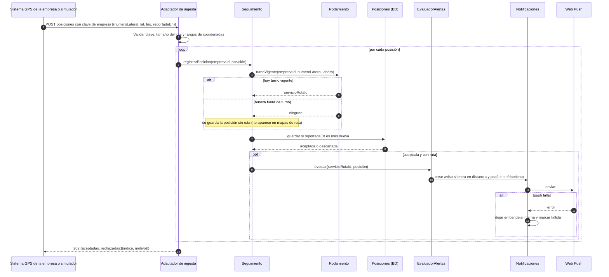
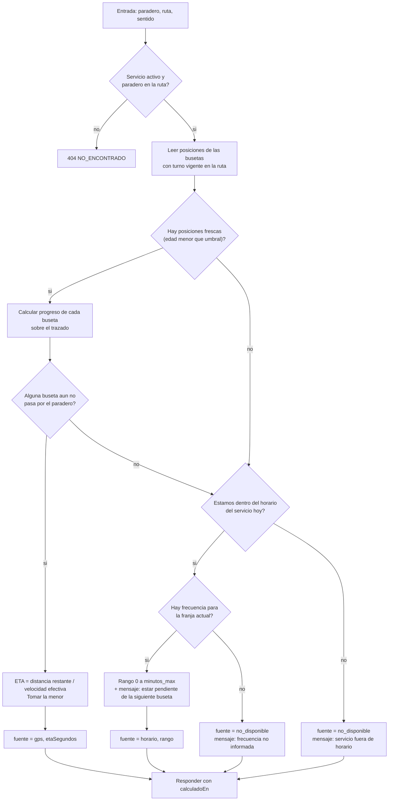
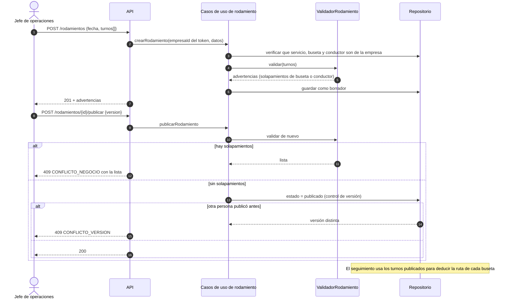
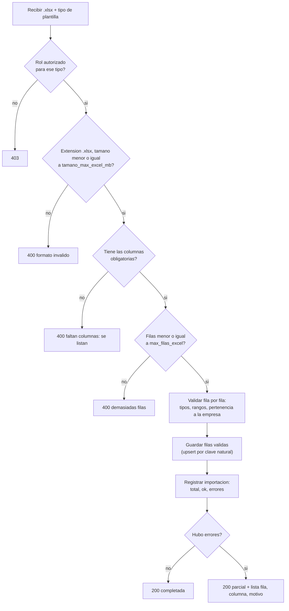
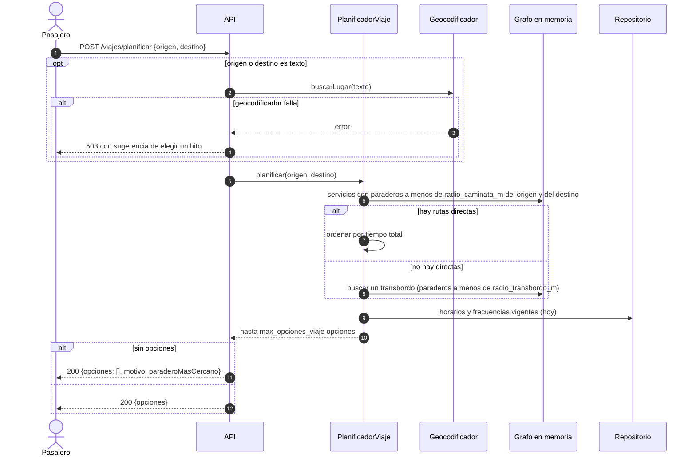
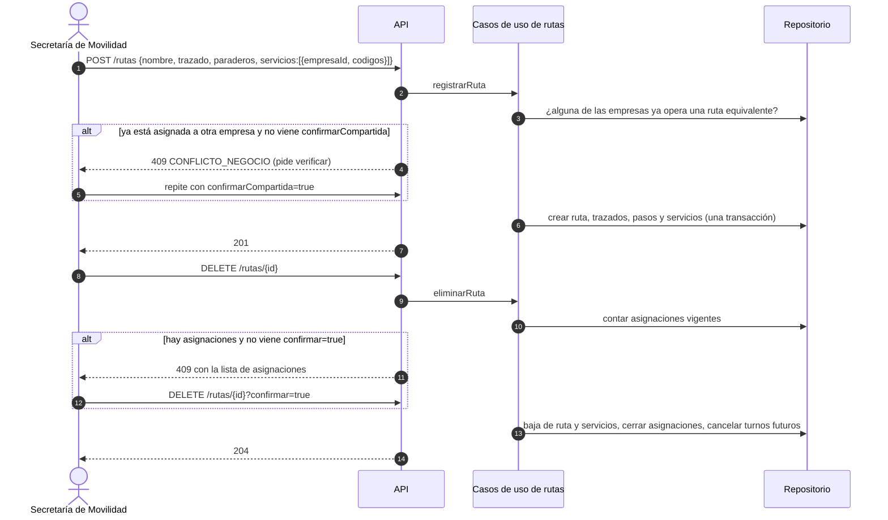
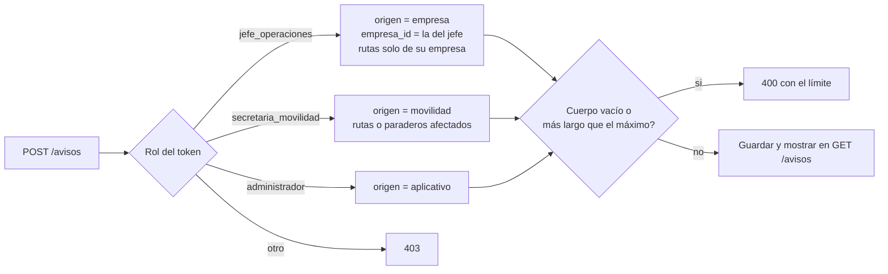

# Actividad 3 — Casos de uso y flujos

> **Convención:** un caso de uso por historia de usuario (`UC-<id de la HU>`). Los flujos principal, alternativo y de excepción **son los de las HU y las SPEC** [FUENTE]. Los pasos adicionales (reglas, datos faltantes, fallas de servicios externos) son [PROPUESTO] y están marcados.
> Los roles, el estado de los datos y los supuestos `S-xx` están en `00-indice-y-supuestos.md`.

## 1. Convenciones transversales

| Código | Situación | Comportamiento del sistema |
|---|---|---|
| CT-01 | La base de datos o un servicio propio no responde | La API responde `503 SERVICIO_EXTERNO_NO_DISPONIBLE` con `reintentable: true`. La interfaz muestra "mensaje de error temporal" y botón **Reintentar**. |
| CT-02 | Dato faltante en un recurso | El recurso se devuelve con el campo `null` o la lista vacía y un `estado` explícito (ej. `pendiente_actualizacion`). Nunca se inventa el valor. |
| CT-03 | Conflicto de versión (RNF-02) | `409 CONFLICTO_VERSION` con la versión actual. La interfaz ofrece recargar y reaplicar. |
| CT-04 | Sin sesión en una acción que la exige | `401 NO_AUTENTICADO` con mensaje "Inicia sesión para guardar" (BR-02). La interfaz lleva a registro o inicio de sesión y vuelve a la acción. |
| CT-05 | Rol o empresa no permitidos | `403 NO_AUTORIZADO`. Los datos de otra empresa responden `404` para no revelar su existencia. |
| CT-06 | Mapa base no carga (teselas) | Falla del **cliente**; el backend no interviene. La interfaz muestra aviso de error de conexión y permite reintentar (HU-P01 excepción). |
| CT-07 | Datos de posición desactualizados | Una posición con más de `umbral_posicion_obsoleta_s` se trata como `sin_senal`. |
| CT-08 | Respuesta con cambios entre consultas | Las consultas en vivo devuelven `calculadoEn`; la interfaz muestra "actualizado hace N s" y marca como desactualizado si pasan más de 3 intervalos de refresco. |

---

## 2. Casos de uso del pasajero (sin cuenta salvo P10 y P11)

### UC-P01 — Ver rutas y paradas en el mapa (HU-P01, RF-001-01, AC-001-01)
| Campo | Contenido |
|---|---|
| Actor / precondición | Pasajero con o sin cuenta (BR-01). La interfaz obtiene su ubicación si el usuario la concede, o usa el centro de la ciudad. |
| Principal | 1) El pasajero abre la app y la vista de mapa. 2) Busca la ruta que desea tomar. 3) El sistema carga rutas y paraderos cercanos a su origen (`radio_busqueda_m`). 4) El pasajero visualiza la red. |
| Alternativo | No hay rutas cercanas: el sistema devuelve el **paradero más cercano a la ruta que desea tomar** (HU-P01). |
| Excepción | El servicio de mapas no carga: aviso de error de conexión con reintento (CT-06). Si falla la API: CT-01. |
| Datos faltantes | Ubicación del usuario denegada: se usa el hito o la dirección que escriba; si no hay ninguno, se muestra la ciudad completa. [PROPUESTO] |
| Postcondición | Se registra un `EventoUso` anónimo (no bloqueante). |

### UC-P02 — Ver el recorrido de una ruta (HU-P02, RF-001-02, AC-001-02)
| Campo | Contenido |
|---|---|
| Principal | 1) El pasajero selecciona una ruta. 2) El sistema devuelve el trazado por sentido y los paraderos ordenados. 3) La interfaz resalta el recorrido. |
| Alternativo | La ruta no existe o fue dada de baja: `404`; el sistema muestra rutas cercanas que van hacia el destino indicado. |
| Excepción | Falla al renderizar el mapa: aviso de error y sugerencia de recargar. |
| Reglas | Ruta con variantes: se muestran el tronco y las variantes con selector. Ruta circular: un solo sentido `circular` sin selector de ida/vuelta. Si la ruta la operan varias empresas, se listan sus servicios. [PROPUESTO S-03, S-05] |

### UC-P03 — Consultar horarios y días de operación (HU-P03, RF-002-01, AC-002-01)
| Campo | Contenido |
|---|---|
| Principal | 1) El pasajero selecciona una ruta (y empresa si hay varias). 2) El sistema muestra, por tipo de día, primera salida, última salida y cierre. |
| Alternativo | El servicio no tiene horarios: estado `pendiente_actualizacion` y mensaje "información pendiente de actualización". Se aplica a cada tipo de día faltante (ej. sábado de Sideral). |
| Excepción | Base de datos no responde: CT-01. |
| Reglas | El día de hoy se resalta según la derivación de tipo de día. Un aviso vigente de festivo de la empresa se muestra encima. |

### UC-P04 — Ver frecuencia por franja horaria (HU-P04, RF-002-02, AC-002-02)
| Campo | Contenido |
|---|---|
| Principal | 1) El pasajero selecciona una ruta. 2) El sistema muestra la frecuencia por franja y tipo de día. |
| Alternativo | Frecuencia variable (`minutos_min` distinto de `minutos_max`): se muestra un rango "de 10 a 15 min". |
| Excepción | Servicio de datos no responde: mensaje de error y sugerencia de intentar más tarde. |
| Datos faltantes | Sin frecuencias: "frecuencia no informada por la empresa". No se estima. |

### UC-P05 — Ver ubicación en tiempo real (HU-P05, RF-003-01, AC-003-01)
| Campo | Contenido |
|---|---|
| Principal | 1) El pasajero selecciona una ruta. 2) El sistema muestra las busetas activas. 3) La interfaz consulta cada `intervalo_refresco_cliente_s` (5 s, S-08) y mueve los marcadores. |
| Alternativo | No hay busetas activas: "no hay unidades en servicio" y `unidadesEnServicio: 0`. |
| Excepción | Señal GPS perdida (posición más vieja que `umbral_posicion_obsoleta_s`): la buseta aparece como `sin_senal` y el mensaje "ubicación no disponible". |
| Reglas | Solo se muestran busetas con turno vigente en la ruta (por rodamiento). Si la fuente de posiciones no está disponible (OPEN-Q-003 sin resolver), la pantalla muestra "seguimiento no disponible" y el ETA usa el horario. |

### UC-P06 — Conocer el ETA a una parada (HU-P06, RF-003-02, AC-003-02)
| Campo | Contenido |
|---|---|
| Principal | 1) El pasajero selecciona un paradero y una ruta (sentido). 2) El sistema calcula el ETA con GPS. 3) Muestra el tiempo restante y la buseta. |
| Alternativo | La buseta perdió la ubicación: el sistema avisa que debe estar pendiente de la siguiente buseta. Si ninguna tiene posición, usa el **respaldo por horario y frecuencia** (SPEC: "sistema de respaldo en caso de que el GPS falle"). |
| Excepción | El cálculo falla: mensaje de error y solicitud de reintentar. |
| Reglas | `fuente = gps` (hora exacta aproximada), `horario` (rango) o `no_disponible`. Fuera del horario del servicio: `no_disponible` con "el servicio ya cerró" o "aún no inicia". Ver diagrama D2. [PROPUESTO S-19] |

### UC-P07 — Planificar un viaje (HU-P07, RF-004-01, AC-004-01)
| Campo | Contenido |
|---|---|
| Principal | 1) El pasajero indica origen y destino (coordenadas, hito o texto). 2) El sistema sugiere hasta `max_opciones_viaje` opciones directas. 3) El pasajero elige. |
| Alternativo | No hay rutas directas: sugiere opciones con **un transbordo** (S-20). |
| Excepción | El planificador no responde: aviso de error. Falla del geocodificador al resolver el texto: se pide elegir un hito o tocar el mapa. |
| Datos faltantes | Origen o destino sin rutas a pie dentro de `radio_caminata_m`: "no hay rutas cerca de ese punto" y se sugiere el paradero más cercano. |
| Reglas | Tiempo total = caminata + espera (según frecuencia del servicio) + trayecto. Se descartan servicios fuera de horario. |

### UC-P08 — Buscar por número o nombre de ruta (HU-P08, RF-005-01, AC-005-01)
| Campo | Contenido |
|---|---|
| Principal | 1) El pasajero escribe. 2) El sistema filtra por nombre, código público y código interno, sin distinguir tildes ni mayúsculas. 3) Selecciona. |
| Alternativo | Sin coincidencias: mensaje "sin resultados". |
| Excepción | El buscador falla: "error de búsqueda". |
| Reglas | Una ruta compartida aparece una vez con las empresas que la operan. Una ruta sin código (Serviturismo) solo se encuentra por nombre. |

### UC-P09 — Buscar por barrio, sector o punto de interés (HU-P09, RF-005-02, AC-005-02)
| Campo | Contenido |
|---|---|
| Principal | 1) El pasajero escribe o elige un hito o barrio. 2) El sistema lista las rutas que pasan a menos de `radio_hito_m`. 3) Elige. |
| Alternativo | Ninguna ruta pasa por el punto: "no hay cobertura" y se muestra el paradero más cercano. |
| Excepción | El servicio de búsqueda falla: mensaje de error. |
| Reglas | La búsqueda por hito es prioritaria (contexto §5): los hitos aceptan alias y se ordenan por relevancia. |

### UC-P10 — Guardar favoritas (HU-P10, RF-008-01, AC-008-01) — requiere cuenta (BR-02)
| Campo | Contenido |
|---|---|
| Principal | 1) El pasajero inicia sesión. 2) Marca una ruta o paradero. 3) El sistema guarda. |
| Alternativo | Sin sesión: CT-04 (solicita registro). Favorito ya existente: se responde con el existente (idempotente). |
| Excepción | Error al guardar: "no se pudo guardar". |
| Reglas | Un favorito de una ruta dada de baja se muestra marcado "ya no disponible". |

### UC-P11 — Recibir notificación de llegada (HU-P11, RF-009-01, AC-009-01) — requiere cuenta
| Campo | Contenido |
|---|---|
| Principal | 1) El pasajero activa una alerta (ruta, paradero y distancia). 2) El sistema vigila las posiciones. 3) Cuando una buseta está a menos de la distancia, envía el aviso. |
| Alternativo | La buseta se desvía (distancia a la ruta mayor que `umbral_desvio_m`): se notifica el cambio de estado. |
| Excepción | Falla el servicio de notificaciones: el aviso queda en la **bandeja dentro de la app** y se informa que el push no se pudo enviar. |
| Reglas | La distancia por defecto es `distancia_aviso_llegada_m` y la configura el administrador (S-10). Un solo aviso por paso de buseta (`enfriamiento_alerta_min`). Canal: Web Push y bandeja interna (S-09, OPEN-Q-001). |

### UC-P12 — Usar la app sin cuenta (HU-P12, RF-010-01, AC-010-01)
| Campo | Contenido |
|---|---|
| Principal | 1) El pasajero abre la app. 2) Consulta rutas, horarios, mapa, ETA y avisos sin registrarse. |
| Alternativo | Intenta guardar favoritos o crear alertas: se solicita registro (CT-04). |
| Excepción | Error de carga inicial: mensaje con reintento. |
| Reglas | Ningún endpoint público exige token. No se guarda la ubicación del usuario (S-16). |

---

## 3. Casos de uso del jefe de operaciones (solo su empresa, OPEN-Q-004 / S-11)

### UC-J01 — Asignar conductores y busetas a rutas (HU-J01, RF-006-01, AC-006-01)
| Campo | Contenido |
|---|---|
| Precondición | Los servicios de ruta de la empresa existen (los asignó la Secretaría, BR-03). La buseta y el conductor existen. |
| Principal | 1) El jefe entra al módulo. 2) Selecciona servicio de ruta, buseta y conductor. 3) El sistema guarda la asignación. |
| Alternativo | Ya existe una asignación de esa buseta a ese servicio con otro conductor: el sistema pide **confirmación de cambio** y, con `confirmarCambio=true`, reemplaza. [SUPUESTO S-04] |
| Excepción | Error al guardar: mensaje de error. Una buseta en otra empresa o un servicio ajeno: `404`. |
| Reglas | Una buseta puede estar asignada a varias rutas (contexto §8.2.6). |

### UC-J02 — Ingresar datos operativos manualmente (HU-J02, RF-006-02, AC-006-02)
| Campo | Contenido |
|---|---|
| Alcance | Por BR-03 el jefe **no crea ni edita rutas ni paraderos**. Este caso de uso cubre los datos operativos que sí le corresponden: **horarios, frecuencias, conductores, busetas y códigos internos de su servicio**. [SUPUESTO S-02] |
| Principal | 1) El jefe ingresa los datos. 2) El sistema valida. 3) Guarda. |
| Alternativo | Datos incompletos o inválidos (hora de cierre anterior a la primera salida, franjas solapadas, `min` mayor que `max`): se solicita corregir los campos señalados. |
| Excepción | Error de conexión: reintentar. Conflicto de versión: CT-03. |

### UC-J03 — Subir Excel (HU-J03, RF-006-03, AC-006-03)
| Campo | Contenido |
|---|---|
| Alcance | Plantillas para el jefe: `conductores`, `busetas`, `asignaciones`, `horarios_frecuencias`, `rodamiento`. (Las rutas y paraderos se importan solo por la Secretaría, UC-SM01/SM04.) [SUPUESTO S-02] |
| Principal | 1) El jefe carga el archivo `.xlsx`. 2) El sistema procesa fila por fila. 3) Confirma la importación con el total de filas correctas. |
| Alternativo | Formato inválido (no es `.xlsx`, faltan columnas, supera `tamano_max_excel_mb` o `max_filas_excel`): error de formato, no se procesa nada. |
| Excepción | Error en el procesamiento: el sistema indica **qué filas fallaron** (fila, columna, motivo). Las filas correctas se conservan (S-18). |
| Reglas | Idempotente: cargar el mismo archivo dos veces no duplica conductores ni busetas (clave: número lateral / nombre). Ver diagrama D4. |

### UC-J04 — Definir el rodamiento del día (HU-J04, RF-006-04, AC-006-04)
| Campo | Contenido |
|---|---|
| Principal | 1) El jefe define los turnos (servicio, buseta, conductor, hora de salida). 2) El sistema guarda como borrador. 3) El jefe lo **publica** y queda activo para la fecha. |
| Alternativo | Conflicto de horarios: el sistema **alerta sobre solapamientos** (misma buseta, mismo instante, o mismo conductor). Guarda como borrador con advertencias; **bloquea la publicación** mientras existan solapamientos. [PROPUESTO D-14] |
| Excepción | Error al guardar: "error de sistema". |
| Reglas | Fecha desde hoy hasta 15 días adelante (Socobuses planifica con 8 días, hasta 15; contexto §8.1). Fuente: manual o Excel (OPEN-Q-007, S-02). Turno de buseta sin asignación a ese servicio: error de validación. Ver diagrama D3. |

### UC-J05 — Publicar avisos de la empresa (HU-J05, RF-011-01, AC-011-01)
| Campo | Contenido |
|---|---|
| Principal | 1) El jefe redacta el aviso. 2) El sistema publica con origen `empresa`. 3) Los pasajeros lo ven. |
| Alternativo | Aviso más largo que `longitud_max_aviso`: el sistema **limita la longitud** y responde `400` con el límite. |
| Excepción | Error de publicación: mensaje de error. |
| Reglas | Sirve para desvíos, varadas y horarios de festivos (contexto §8.2.7). Puede asociar rutas de su empresa. |

### UC-J06 — Consultar estadísticas básicas de uso (HU-J06, RF-012-01, AC-012-01)
| Campo | Contenido |
|---|---|
| Principal | 1) El jefe accede a estadísticas. 2) El sistema muestra consultas por ruta y por día de **su empresa**. 3) El jefe analiza. |
| Alternativo | No hay datos suficientes: mensaje "sin datos". |
| Excepción | Error de carga: mensaje de error. |
| Reglas | Basadas en `EventoUso` anónimos (S-12). Rango máximo configurable. Solo rutas de su empresa. |

---

## 4. Casos de uso de la Secretaría de Movilidad

### UC-SM01 — Registrar una ruta y asignarla a una empresa (HU-SM01, RF-007-01, AC-007-01)
| Campo | Contenido |
|---|---|
| Principal | 1) La Secretaría ingresa nombre, tipo de recorrido, trazado y paraderos ordenados. 2) Asigna una o más empresas (crea los servicios, con código público e interno opcionales). 3) El sistema guarda. |
| Alternativo | La ruta ya está asignada a otra empresa: el sistema **pide verificar**. Como las rutas pueden compartirse (contexto §8.2.2), la Secretaría puede **confirmar** que es compartida y se crea un segundo servicio. [SUPUESTO S-03] |
| Excepción | Empresa no encontrada o error de sistema: mensaje de error. |
| Reglas | Variante: se indica la ruta principal. Importable por Excel (`rutas_paraderos`). |

### UC-SM02 — Editar una ruta (HU-SM02, RF-007-02, AC-007-02)
Principal: busca la ruta, edita y guarda con `version`. Alternativo: ruta no encontrada → aviso. Excepción: error de escritura → error; conflicto de versión → CT-03.

### UC-SM03 — Eliminar una ruta (HU-SM03, RF-007-03, AC-007-03)
Principal: selecciona, confirma, el sistema da de baja. Alternativo: con asignaciones activas → **advertencia** con la lista; solo procede con `confirmar=true`, cierra las asignaciones y cancela turnos futuros. Excepción: error al eliminar → error. Efecto en favoritos y alertas: pasan a "ya no disponible". Ver diagrama D6.

### UC-SM04 — Gestionar paraderos (HU-SM04, RF-007-04, AC-007-04)
Principal: crea, edita o da de baja un paradero; el mapa se actualiza (el pasajero lo ve en ≤ `10 s` de refresco). Alternativo: paradero duplicado (mismo nombre a menos de 20 m) → avisa. Excepción: error de sistema → error. Baja de un paradero usado por rutas: se advierte con la lista de rutas afectadas.

### UC-SM05 — Registrar un cambio de movilidad (HU-SM05, RF-007-05, AC-007-05)
Principal: registra cierre, desvío, obra o condición, con rutas o paraderos afectados y vigencia; el sistema publica con origen `movilidad`. Alternativo: datos incompletos → avisa. Excepción: error de publicación → error. Regla: el aviso aparece en las rutas afectadas y en el listado general.

---

## 5. Casos de uso del administrador

| Caso | HU / RF / AC | Principal | Alternativo | Excepción |
|---|---|---|---|---|
| UC-A01 Gestionar usuarios | HU-A01 / RF-013-01 / AC-013-01 | Busca el usuario, crea, activa/desactiva o cambia empresa; el sistema guarda | Usuario no encontrado → avisa | Error de sistema |
| UC-A02 Gestionar roles y permisos | HU-A02 / RF-013-02 / AC-013-02 | Configura permisos de rol; el sistema aplica | Rol no válido (fuera de los 4) → avisa | Error de sistema |
| UC-A03 Gestionar empresas | HU-A03 / RF-013-03 / AC-013-03 | Crea o edita empresa; también gestiona credenciales de la fuente de posiciones | Empresa no encontrada → avisa | Error de sistema |
| UC-A04 Configurar parámetros | HU-A04 / RF-013-04 / AC-013-04 | Ajusta un parámetro; el sistema aplica sin reiniciar (lectura con caché ≤ 60 s) | Parámetro inválido (clave o rango) → avisa | Error de sistema |
| UC-A05 Publicar avisos del aplicativo | HU-A05 / RF-013-05 / AC-013-05 | Redacta y publica con origen `aplicativo` | Aviso vacío → avisa | Error de publicación |

Reglas comunes (S-11, S-13): el administrador tiene control total (BR-07), puede publicar avisos y consultar estadísticas globales. Las cuentas de jefe, Secretaría y administrador las crea el administrador; el pasajero se registra solo. Una cuenta no puede quitarse a sí misma el rol de administrador si es el último.

---

## 6. Diagramas de procesos entre módulos

### D1 — Ingesta de posición, rodamiento y alertas (HU-P05, HU-P11)

### D2 — Cálculo del ETA con respaldo por horario (HU-P06)

Velocidad efectiva = velocidad reportada si es mayor o igual a 5 km/h; si no, `velocidad_default_kmh`. Para rutas circulares la distancia restante es módulo la longitud del circuito.

### D3 — Definir y publicar el rodamiento (HU-J04, HU-J01)

### D4 — Importación de Excel (HU-J03, HU-SM01, HU-SM04)

### D5 — Planificar un viaje (HU-P07)

### D6 — La Secretaría registra y elimina rutas (HU-SM01, HU-SM03)

### D7 — Publicación de avisos según el rol (HU-J05, HU-SM05, HU-A05)

---

## 7. Falla de servicios externos y datos faltantes (resumen)

| Servicio / dato | Falla | Comportamiento | HU |
|---|---|---|---|
| Base de datos (Supabase) | No responde | 503 reintentable; la interfaz conserva lo ya cargado y marca desactualizado | todas |
| Fuente de posiciones (empresa) | No envía datos | `sin_senal`, ETA por horario | P05, P06, P11 |
| Posición de una sola buseta | Se pierde | Se oculta del mapa activo, se avisa "ubicación no disponible" | P05 |
| Rodamiento no publicado | Buseta sin turno | La posición se guarda pero no se asigna a una ruta; no se muestra | P05 |
| Geocodificador | No responde | Se pide elegir un hito o el mapa; no se bloquea la planificación por coordenadas | P07 |
| Web Push | Falla | Bandeja interna + `Notificacion.estado = fallida` | P11 |
| Mapa base (teselas) | No carga | Error en el cliente con reintento | P01, P02 |
| Autenticación (Supabase Auth) | No responde | Las consultas públicas siguen funcionando; las acciones con cuenta devuelven 503 | P10, P11, J*, SM*, A* |
| Archivo Excel | Corrupto o con filas inválidas | Rechazo total o importación parcial con detalle | J03, SM01, SM04 |
| Horarios o frecuencias sin cargar | Faltan | `pendiente_actualizacion`, nunca se inventan | P03, P04 |
| Calendario de festivos | Sin cargar | Se usa el día de la semana; los avisos de la empresa cubren el festivo | P03 |
