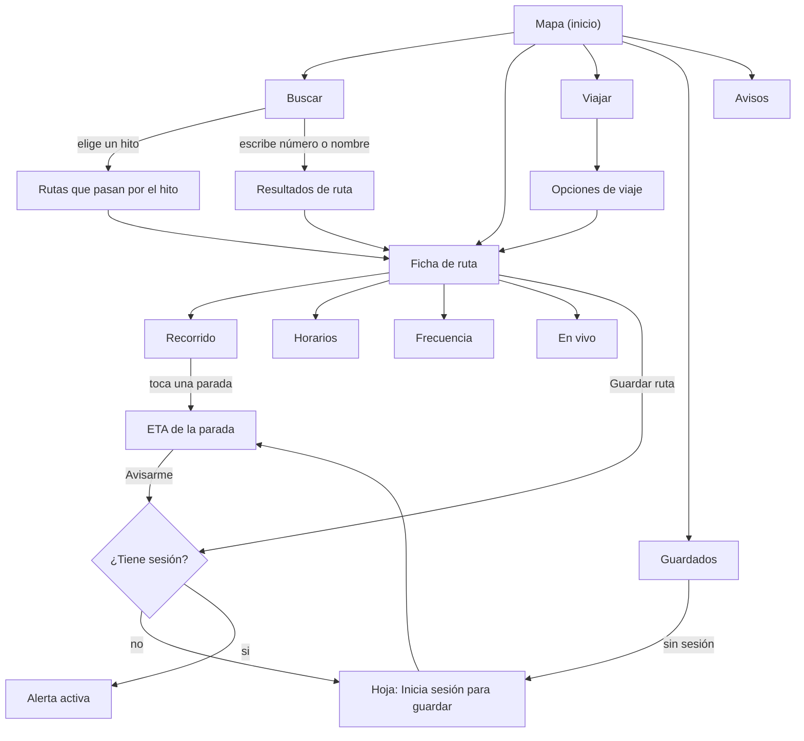
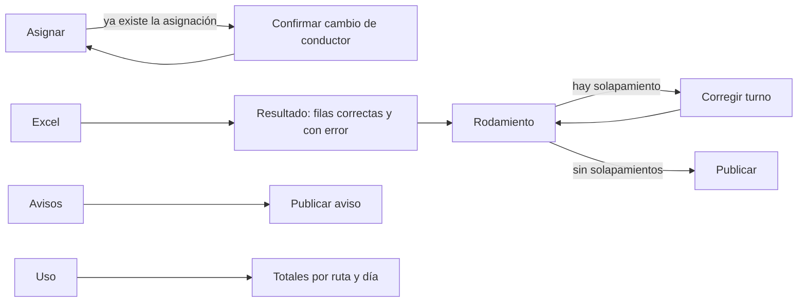
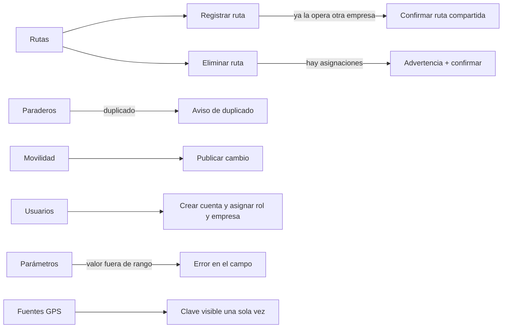

# Actividad 4 — Experiencia de usuario y prototipos

> **Prototipo de alta fidelidad:** `prototipo.html` (un solo archivo, se abre en el navegador). Cubre las pantallas principales de los cuatro roles y permite **simular** estados: cargando, sin conexión, busetas sin señal, sin resultados y datos desactualizados.
> **Etiquetas:** [FUENTE] viene de los documentos; [PROPUESTO] es una propuesta de diseño; [SUPUESTO S-xx] está en `00-indice-y-supuestos.md`.
> **Datos del prototipo:** son de ejemplo. Los **horarios y frecuencias** de Socobuses, Sideral y Serviturismo salen del levantamiento de campo (contexto §8.1), así como los hitos (Catedral, El Cable, Carrera 23, Fundadores) y los números laterales 2683 (La Enea) y 2676 (Villamaría). Los códigos de ruta de Socobuses, los demás números laterales, los nombres de paradas y de conductores son **ficticios**. El mapa es esquemático, no es cartografía real.

---

## 1. Principios de diseño [PROPUESTO]

| Principio | Por qué (fuente) | Cómo se ve en el prototipo |
|---|---|---|
| **El hito primero** | Los usuarios se orientan por hitos urbanos, no por paraderos formales (contexto §1 y §8.2.9) | La búsqueda ofrece hitos como atajos y es la acción principal del mapa |
| **Cobertura y horario antes que detalle** | Las preguntas al conductor son casi siempre sobre cobertura y horarios (contexto §1) | La ficha de ruta abre en Recorrido y Horarios está a un toque |
| **Sin cuenta por defecto** | BR-01 | Solo se pide cuenta para guardar y avisar; el mensaje lo dice antes |
| **Nunca inventar un dato** | Datos faltantes (SPEC §9) | "Información pendiente de actualización" en lugar de un horario vacío |
| **Tiempo real con respaldo visible** | OPEN-Q-003 y SPEC "sistema de respaldo" | El ETA dice su fuente: GPS u horario |
| **Legible al sol y en movimiento** | Uso en la calle desde el celular (RNF-03) | Contraste alto, texto grande, objetivos táctiles de 44 px o más |
| **Desde 320 px** | RNF-03 | Una sola columna; el panel de pruebas se pliega en móvil |

Identidad visual: ciudad de laderas → **curvas de nivel** como fondo del mapa; verde cafetal como color de acción; amarillo solo para las busetas en vivo; rojo ladrillo solo para errores. Tipografía: Bricolage Grotesque (títulos) y Atkinson Hyperlegible (texto), pensada para lectura rápida. Modo oscuro automático según el sistema.

---

## 2. Flujos de navegación

### 2.1 Pasajero (sin cuenta salvo Guardados)



### 2.2 Jefe de operaciones



### 2.3 Secretaría de Movilidad y administrador



---

## 3. Inventario de pantallas

| ID | Pantalla | Rol | HU | En el prototipo |
|---|---|---|---|---|
| PAN-P01 | Mapa con rutas y paradas cercanas | Pasajero | P01, P12 | sí |
| PAN-P02 | Ficha de ruta: Recorrido | Pasajero | P02 | sí |
| PAN-P03 | Ficha de ruta: Horarios (por empresa y tipo de día) | Pasajero | P03 | sí |
| PAN-P04 | Ficha de ruta: Frecuencia | Pasajero | P04 | sí |
| PAN-P05 | Ficha de ruta: En vivo | Pasajero | P05 | sí |
| PAN-P06 | ETA de una parada | Pasajero | P06, P11 | sí |
| PAN-P07 | Planificar viaje y opciones | Pasajero | P07 | sí |
| PAN-P08 | Buscar por número o nombre | Pasajero | P08 | sí |
| PAN-P09 | Buscar por hito o barrio | Pasajero | P09 | sí |
| PAN-P10 | Guardados (favoritas, alertas, notificaciones) | Pasajero registrado | P10, P11 | sí |
| PAN-P11 | Hoja "Inicia sesión para guardar" | Pasajero | P10, P11, P12 | sí |
| PAN-P12 | Avisos | Todos | J05, SM05, A05 | sí |
| PAN-P13 | Registro e inicio de sesión | Pasajero | P10 | solo la hoja de entrada |
| PAN-J01 | Rodamiento (tabla de turnos, solapamientos, publicar) | Jefe | J04 | sí |
| PAN-J02 | Asignar buseta y conductor | Jefe | J01 | sí |
| PAN-J03 | Importar Excel y resultado por fila | Jefe | J03 | sí |
| PAN-J04 | Datos operativos: horarios, frecuencias, conductores, busetas | Jefe | J02 | [PROPUESTO] por definir en detalle |
| PAN-J05 | Publicar aviso de la empresa | Jefe | J05 | sí |
| PAN-J06 | Estadísticas de uso | Jefe | J06 | sí |
| PAN-S01 | Rutas: lista, registrar, eliminar | Secretaría | SM01..SM03 | sí |
| PAN-S02 | Editor de trazado y paraderos de una ruta | Secretaría | SM01, SM02 | [PROPUESTO] por definir en detalle |
| PAN-S03 | Paraderos | Secretaría | SM04 | sí |
| PAN-S04 | Cambio de movilidad | Secretaría | SM05 | sí |
| PAN-A01 | Usuarios y roles | Admin | A01, A02 | sí |
| PAN-A02 | Empresas | Admin | A03 | combinado con PAN-A04 |
| PAN-A03 | Parámetros | Admin | A04 | sí |
| PAN-A04 | Fuentes de GPS (claves por empresa) | Admin | A03, [S-01] | sí |
| PAN-A05 | Avisos del aplicativo | Admin | A05 | reutiliza PAN-J05 con otro origen |

---

## 4. Wireframes (pantallas principales a 360 px)

### PAN-P01 — Mapa

```text
┌────────────────────────────┐
│ Datos de ejemplo           │  (solo prototipo)
├────────────────────────────┤
│ ┌────────────────────────┐ │
│ │ 🔍 ¿A dónde vas?       │ │  ← acción principal: abre Buscar
│ └────────────────────────┘ │
│   ╭────── curvas de nivel ─╮│
│   │   ◆ El Cable          ││
│   │     ╲  [1544]         ││  ← bus en vivo (amarillo, número lateral)
│   │  ◆ Catedral           ││
│   │ ●─── ◆ Fundadores     ││  ← ruta (color), parada ●, hito ◆
│   │  [2683]    (•) tú     ││
│   ╰────────────────────────╯│
├────────────────────────────┤
│  ───                       │  ← hoja deslizable
│ Rutas cerca de ti          │
│ [39] El Cable              │
│      Sideral · a 220 m     │
│      2 en servicio         │
│ [18] La Enea …             │
├────────────────────────────┤
│ Mapa  Buscar Viajar Guard. │
└────────────────────────────┘
```

### PAN-P02..P05 — Ficha de ruta

```text
┌────────────────────────────┐
│ [<]  El Cable          [🔖] │
│ [39] Sideral               │
│ (La Enea: chips por empresa│
│  [Socobuses·18][Servitur.] )│
│ ┌ mapa con la ruta ───────┐│
│ └─────────────────────────┘│
│ Recorrido|Horarios|Frecuencia|En vivo
│ [Ida][Vuelta]              │
│ ●─ Terminal                │
│ │   toca para ver cuánto falta
│ ●─ Carrera 23              │
│ ●─ Fundadores …            │
└────────────────────────────┘
Horarios:  Día | Primera | Última | Cierre
           Lun–vie (hoy) 04:45  21:30  —
           Sábados  "Información pendiente de actualización"
           Dom/fest 06:00  21:00  —
```

### PAN-P06 — ETA de una parada

```text
┌────────────────────────────┐
│ [<]  Parada Fundadores     │
│ ┌────────────────────────┐ │
│ │ [39] El Cable · ida    │ │
│ │ 4 min                  │ │  ← fuente GPS
│ │ Buseta 1544 viene hacia aquí
│ │ Fuente: GPS · hace 3 s │ │
│ └────────────────────────┘ │
│ [ Avisarme cuando esté a 300 m ]
│ Las alertas necesitan una cuenta …
└────────────────────────────┘
Sin GPS:  "Hasta 15 min"  + aviso "Sin ubicación de busetas.
          Estimación por horario … Esté pendiente de la siguiente buseta."
```

### PAN-P07 — Viajar

```text
┌────────────────────────────┐
│ Planifica tu viaje         │
│ Origen   [Mi ubicación   ] │
│ Destino  [Catedral       ] │
│ [ Buscar rutas ]           │
│ Directa · El Cable   22 min│
│ ▓▓░░░░▒▒▒▒▒▒▒▒▒▒▒▒▒▒▒▒▒    │  caminata | espera | buseta
│ 4 a pie · 6 espera · 12 bus│
│ Con transbordo …     31 min│
└────────────────────────────┘
```

### PAN-J01 — Rodamiento

```text
┌────────────────────────────┐
│ Rodamiento de mañana       │
│ Sideral · miércoles · borrador
│ ┌ ⚠ Hay 1 solapamiento ───┐│
│ │ La buseta 1520 sale a las 06:40 y todavía
│ │ está en el turno de 06:00–06:50   [Corregir]
│ └─────────────────────────┘│
│ Buseta | Ruta | Conductor | Salida
│ 1520   | El Cable | Carlos R. | 06:00
│ 1520   | Centro   | Carlos R. | 06:40  ← fila marcada
│ …                          │
│ [ Publicar rodamiento ] (inactivo)
│ Corrige el solapamiento para poder publicar.
└────────────────────────────┘
```

### PAN-S01 — Rutas (Secretaría)

```text
┌────────────────────────────┐
│ Rutas de la ciudad         │
│ [39] El Cable  Sideral     [Eliminar]
│ [18] La Enea  Socobuses · Serviturismo · compartida
│ …                          │
│ Registrar ruta             │
│ Nombre [__]  Tipo [Lineal|Circular]
│ Variante de [__] Empresa [__]
│ [ Registrar ruta ]         │
└────────────────────────────┘
```

(Los demás wireframes están implementados directamente en `prototipo.html`.)

---

## 5. Componentes

| ID | Componente | Variantes y estados | Usado en |
|---|---|---|---|
| COM-01 | Mapa esquemático | Normal; ruta resaltada (el resto atenuado); con busetas en vivo; busetas sin señal (gris); sin rutas cercanas | P01, P02, P05 |
| COM-02 | Marcador de buseta | Activa (amarillo con número lateral); sin señal (gris) | Mapa, En vivo |
| COM-03 | Sello de ruta | Color de ruta + código público; sin código → inicial del nombre | Listas, ficha |
| COM-04 | Fila de lista | Normal; con detalle; deshabilitada ("ya no disponible") | Rutas, favoritos |
| COM-05 | Chip | Normal; seleccionado | Empresas, sentido, hitos |
| COM-06 | Pestañas | 4 pestañas con desplazamiento horizontal si no caben | Ficha de ruta |
| COM-07 | Tabla de horarios | Fila de hoy resaltada; fila "pendiente de actualización" | Horarios |
| COM-08 | Barra de tramos del viaje | Caminata, espera, buseta por ruta | Viajar |
| COM-09 | Tarjeta de ETA | GPS (minutos); horario (rango); no disponible | ETA |
| COM-10 | Banner de estado | Error; aviso; información | Todas |
| COM-11 | Vacío con acción | Título, causa y siguiente paso | Todas |
| COM-12 | Esqueleto de carga | Filas de 56 px | Todas |
| COM-13 | Campo de formulario | Normal; con error (borde grueso y texto); con ayuda | Formularios |
| COM-14 | Hoja modal de confirmación | Inicio de sesión; cambio de asignación; ruta compartida; eliminar | Varias |
| COM-15 | Aviso (tarjeta) | Insignia de origen: Movilidad, Empresa, Aplicación | Avisos |
| COM-16 | Aviso emergente (toast) | Confirmación de 2,6 s con el mismo verbo que el botón | Acciones |
| COM-17 | Tabla de importación | Fila, columna, motivo | Excel |
| COM-18 | Barras de uso | Consultas por día | Estadísticas |

---

## 6. Estados de interfaz

Cada pantalla que consulta datos define estos estados. [FUENTE] los flujos alternativos y de excepción de las HU; [PROPUESTO] el texto exacto.

| Estado | Cómo se muestra | Causa en el sistema |
|---|---|---|
| **Cargando** | Esqueletos de lista, nunca pantalla en blanco; se mantiene lo ya cargado si es una actualización | Petición en curso |
| **Vacío** | Título + causa + acción siguiente (COM-11) | `[]`, `cobertura:false`, `unidadesEnServicio:0` |
| **Error de conexión** | Banner rojo arriba con **Reintentar**; se conserva el contenido anterior | 503 `SERVICIO_EXTERNO_NO_DISPONIBLE`, mapa que no carga |
| **Error de validación** | Mensaje bajo el campo, borde grueso; el botón no se deshabilita hasta que se corrige | 400 `VALIDACION` |
| **Datos desactualizados** | Banner amarillo "Última actualización hace N min" + **Actualizar** | `calculadoEn` con más de 3 intervalos de refresco |
| **Sin señal de la buseta** | Marcador gris, texto "Ubicación no disponible" | `estado: sin_senal` |
| **Respaldo por horario** | Tarjeta de ETA con "Hasta N min" y la fuente | `fuente: horario` |
| **Información pendiente** | "Información pendiente de actualización" en la celda | Sin horario o frecuencia |
| **Sin permiso / sin sesión** | Hoja "Inicia sesión para guardar"; al entrar vuelve a la acción | 401 |
| **Conflicto de edición** | Hoja "Alguien más cambió esto. Recarga para ver los cambios" | 409 `CONFLICTO_VERSION` |
| **Éxito** | Aviso emergente con el verbo del botón: Publicar → "Publicado" | 2xx |

### 6.1 Matriz de estados por pantalla

| Pantalla | Cargando | Vacío | Error de red | Desactualizado | Sin señal | Validación |
|---|:--:|:--:|:--:|:--:|:--:|:--:|
| Mapa | ✔ | ✔ (sin rutas a 800 m) | ✔ | ✔ | ✔ (busetas grises) | — |
| Ficha de ruta | ✔ | ✔ (sin horarios, sin unidades) | ✔ | ✔ | ✔ | — |
| ETA | ✔ | ✔ (no disponible) | ✔ | ✔ | ✔ (respaldo) | — |
| Buscar | ✔ | ✔ (sin resultados) | ✔ | — | — | — |
| Viajar | ✔ | ✔ (sin rutas cerca) | ✔ | — | — | ✔ |
| Guardados | ✔ | ✔ (sin sesión; sin alertas) | ✔ | — | — | — |
| Avisos | ✔ | ✔ | ✔ | ✔ | — | — |
| Rodamiento | ✔ | ✔ | ✔ | — | — | ✔ (solapamientos) |
| Excel | ✔ | — | ✔ | — | — | ✔ (por fila) |
| Estadísticas | ✔ | ✔ (sin datos) | ✔ | — | — | — |
| Formularios de gestión | — | — | ✔ | — | — | ✔ |

---

## 7. Textos de la interfaz [PROPUESTO]

Reglas: oraciones en minúscula inicial salvo la primera palabra, verbos claros, un mismo verbo por acción en todo el flujo, errores que dicen qué pasó y cómo seguir, sin disculpas.

| Situación | Texto |
|---|---|
| Búsqueda sin resultados | "Sin resultados para “xyz”. Prueba con un hito como Catedral o con el número de la ruta." |
| Sin rutas cercanas | "No hay rutas a menos de 800 m. El paradero más cercano a la ruta … está en …, a 1,2 km." |
| Sin unidades | "No hay unidades en servicio. Revisa el horario de la ruta." |
| Sin señal | "Ubicación no disponible. Última señal hace más de 60 s." |
| ETA por horario | "Sin ubicación de busetas. Estimación por horario: cada 4 min. Esté pendiente de la siguiente buseta." |
| Horario pendiente | "Información pendiente de actualización" |
| Frecuencia variable | "De 10 a 15 min" |
| Sin sesión | "Inicia sesión para guardar. Con una cuenta guardas rutas y recibes avisos de llegada." |
| Error de conexión | "No se pudo conectar con el servidor. Mostramos lo último que cargó. Revisa tu conexión." |
| Rodamiento con solapamiento | "Hay 1 solapamiento. La buseta 1520 sale a las 06:40 y todavía está en el turno de las 06:00 a las 06:50." |
| Publicar bloqueado | "Corrige el solapamiento para poder publicar." |
| Excel parcial | "Importación parcial: 45 de 48 filas. Las filas correctas ya se guardaron. Corrige las otras 3 y vuelve a cargar el archivo." |
| Ruta compartida | "Esta ruta ya la opera otra empresa. Si también la opera esta empresa, cada una tendrá su propio horario y frecuencia." |
| Eliminar ruta | "Tiene asignaciones activas. Al eliminarla se cierran las asignaciones y se cancelan los turnos futuros." |
| Paradero duplicado | "Ya existe un paradero llamado Fundadores a 12 m. Edítalo o cambia el nombre." |
| Aviso demasiado largo | "El mensaje supera el máximo de 500 caracteres." |
| Parámetro inválido | "Escribe un valor entre 50 y 2000." |
| Clave de GPS | "Copia la clave ahora. No podrás verla otra vez." |

---

## 8. Accesibilidad y adaptación

- **Pantallas desde 320 px** (RNF-03): una sola columna, sin desplazamiento horizontal (verificado en el prototipo a 320 y 360 px).
- Contraste de texto 4.5:1 o más; el color nunca es el único canal (la buseta sin señal también dice "Ubicación no disponible"; los solapamientos tienen texto y fila marcada).
- Objetivos táctiles de al menos 44×44 px; foco visible con anillo amarillo; navegación completa por teclado; roles ARIA en pestañas, diálogos y avisos.
- `prefers-reduced-motion`: el movimiento de las busetas y los esqueletos se detiene.
- Modo oscuro automático (`prefers-color-scheme`).
- Idioma `es`; horas en formato 24 h `HH:MM`; zona horaria de Bogotá.
- En escritorio se mantiene la misma interfaz móvil centrada [PROPUESTO]; un diseño de escritorio específico para jefe, Secretaría y administrador queda para una iteración posterior, porque los flujos son los mismos.

## 9. Cómo usar el prototipo

1. Abrir `prototipo.html` en un navegador.
2. Elegir el rol en **Ver como**.
3. Recorrer: **Pasajero** → Mapa → El Cable → Recorrido → toca "Fundadores" → "Avisarme…" (pide sesión) → entrar. **Jefe** → Rodamiento → Corregir → Publicar. **Secretaría** → Rutas → Registrar (ruta compartida) → Eliminar. **Administrador** → Parámetros → escribir 5000.
4. Marcar los estados en **Simular estados** para ver cada comportamiento (cargando, sin conexión, sin señal, sin resultados, desactualizado).

## 10. Trazabilidad de la Actividad 4

| HU | Pantallas | Estados cubiertos |
|---|---|---|
| P01 | PAN-P01 | vacío (sin rutas), error de mapa |
| P02 | PAN-P02 | ruta inexistente → rutas cercanas |
| P03 | PAN-P03 | información pendiente, error temporal |
| P04 | PAN-P04 | rango variable, error |
| P05 | PAN-P05 | sin unidades, sin señal |
| P06 | PAN-P06 | respaldo por horario, error de cálculo |
| P07 | PAN-P07 | sin rutas directas → transbordo, sin rutas, error |
| P08, P09 | PAN-P08, PAN-P09 | sin resultados, sin cobertura |
| P10, P11, P12 | PAN-P10, PAN-P11 | sin sesión, error al guardar, alerta |
| J01 | PAN-J02 | confirmación de cambio |
| J02 | PAN-J04 | campos incompletos |
| J03 | PAN-J03 | formato inválido, filas fallidas |
| J04 | PAN-J01 | solapamientos, publicar bloqueado |
| J05, SM05, A05 | PAN-J05, PAN-S04, PAN-P12 | aviso largo, aviso vacío |
| J06 | PAN-J06 | sin datos |
| SM01..SM03 | PAN-S01, PAN-S02 | ruta compartida, asignaciones activas |
| SM04 | PAN-S03 | duplicado |
| A01..A04 | PAN-A01, PAN-A03, PAN-A04 | rol inválido, parámetro inválido |
