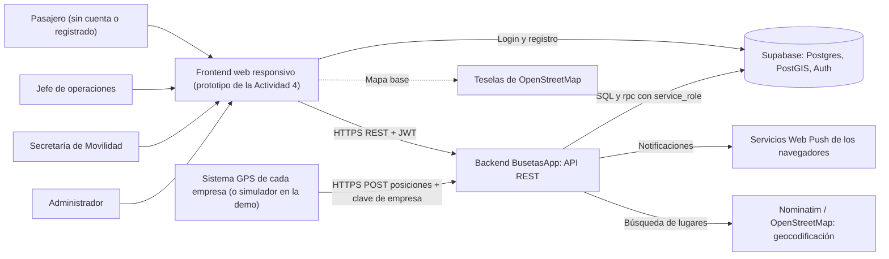
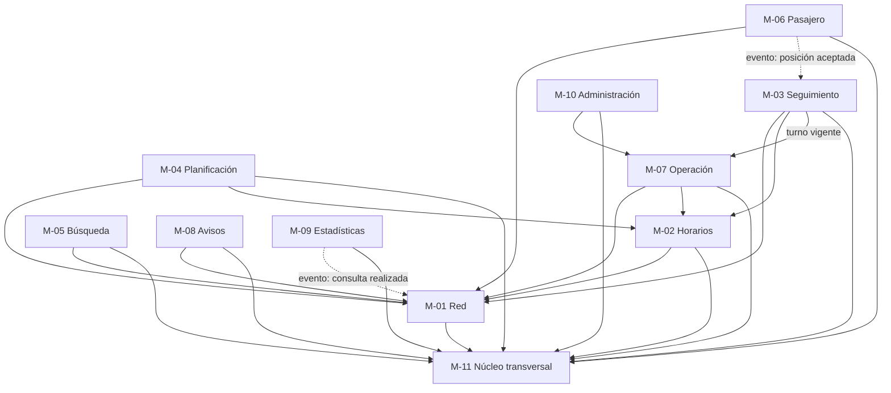
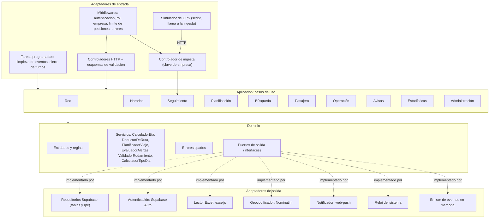
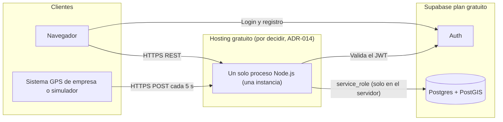

# Actividad 5 — Arquitectura y módulos

> **Estado de las decisiones**
> **[CONFIRMADO]** por el equipo: tecnologías gratuitas, prototipo y **Supabase** como base de datos. El contexto no define tecnología (§6 y §0) y deja la arquitectura para después de las historias.
> **[PROPUESTO]** todo lo demás (arquitectura hexagonal, Node.js/Express, Web Push, etc.). Debe aprobarse; hasta entonces no es una decisión del proyecto.
> Esta actividad parte de `informe_arquitectura_v2.md` (también propuesto) y lo ajusta al contexto: varias empresas por ruta, rutas circulares y variantes, busetas con varias rutas por día, fuente de GPS de las empresas.

## 1. Drivers de arquitectura

| Driver | Origen | Consecuencia |
|---|---|---|
| Prototipo con tecnologías gratuitas | Equipo [CONFIRMADO] | Sin servicios de pago; un solo proceso; sin SLA |
| Base de datos Supabase | Equipo [CONFIRMADO] | Postgres + PostGIS + Auth; consultas espaciales por funciones SQL |
| Consulta sin cuenta | BR-01 | Endpoints públicos sin token |
| Roles y permisos estrictos | BR-02..BR-08 | Autorización por rol y por empresa en cada caso de uso |
| Los conductores no son usuarios | BR-06 | La fuente de GPS es una **empresa**, no un conductor |
| Tiempo real incierto | OPEN-Q-003 | Fuente de posiciones detrás de un **puerto**; ETA con respaldo por horario |
| Concurrencia sin pérdida | RNF-02 | Versión optimista (`version`) en toda escritura |
| HTTPS y sin datos personales en logs | RNF-01 | HTTPS del hosting; `pino` con `redact` |
| Pantallas desde 320 px | RNF-03 | Frontend responsivo; API paginada y ligera |
| Empresas, rutas y variantes heterogéneas | Contexto §8.2 | Modelo `Ruta` + `ServicioRuta` |

## 2. Contexto del sistema



## 3. Módulos y responsabilidades

Monolito modular con **arquitectura hexagonal ligera** [PROPUESTO]. Cada módulo tiene casos de uso (aplicación), entidades y reglas (dominio) y adaptadores (infraestructura). Los módulos no leen tablas de otros; se hablan por casos de uso o por eventos.

| ID | Módulo | Responsabilidad | HU / RF | Roles | Servicios de dominio |
|---|---|---|---|---|---|
| M-01 | **Red** (catálogo) | Rutas, trazados, variantes, paraderos, hitos, servicios de ruta. Lectura pública, escritura de la Secretaría | P01, P02, SM01..SM04 | público, secretaría | `ValidadorRuta` |
| M-02 | **Horarios** | Horarios, frecuencias y calendario de festivos; tipo de día | P03, P04, J02 | público, jefe, admin | `CalculadorTipoDia` |
| M-03 | **Seguimiento** | Ingesta de posiciones, estado de busetas, ETA | P05, P06 | público, fuente GPS | `CalculadorEta`, `DeductorDeRuta` |
| M-04 | **Planificación** | Grafo en memoria y opciones de viaje | P07 | público | `PlanificadorViaje` |
| M-05 | **Búsqueda** | Por texto de ruta y por hito/barrio | P08, P09 | público | — |
| M-06 | **Pasajero** | Favoritos, alertas de llegada, suscripciones push, bandeja de notificaciones | P10, P11, P12 | pasajero | `EvaluadorAlertas` |
| M-07 | **Operación** | Conductores, busetas, asignaciones, rodamiento, importación Excel | J01..J04 | jefe | `ValidadorRodamiento` |
| M-08 | **Avisos** | Avisos de empresa, de movilidad y del aplicativo | J05, SM05, A05 | jefe, secretaría, admin | `PoliticaDeAvisos` |
| M-09 | **Estadísticas** | Registro anónimo de eventos y resúmenes | J06 | jefe, admin | — |
| M-10 | **Administración** | Usuarios, roles, empresas, parámetros, credenciales de fuente GPS | A01..A04 | admin | — |
| M-11 | **Núcleo transversal** | Autenticación, autorización, errores tipados, configuración, logs, reloj, control de versión | RNF-01, RNF-02 | todos | — |

### 3.1 Dependencias entre módulos



Sin ciclos: `M-06` se entera de las posiciones por evento (`posicion.aceptada`), no por llamada directa. `M-03` consulta el turno vigente a `M-07` a través de un puerto de lectura (`PuertoTurnos`).

## 4. Vista hexagonal: puertos y adaptadores



### 4.1 Reglas de dependencia (los agentes de desarrollo las deben cumplir)

```text
dominio          -> (nada)
aplicacion       -> dominio
infraestructura  -> aplicacion, dominio
composicion.js   -> todo (único lugar que construye e inyecta dependencias)
```

- El dominio **no importa** `express`, `@supabase/supabase-js`, `zod`, `exceljs` ni `web-push`.
- Un módulo **no importa** archivos internos de otro módulo; usa su puerto público (`<modulo>/index.js`).
- Los controladores solo traducen HTTP a casos de uso: no tienen reglas de negocio.

## 5. Puertos

### 5.1 Puertos de entrada (casos de uso por módulo)

| Módulo | Casos de uso (nombre en el código) |
|---|---|
| M-01 | `consultarRutasCercanas`, `obtenerDetalleRuta`, `consultarParadasCercanas`, `registrarRuta`, `editarRuta`, `eliminarRuta`, `asignarRutaAEmpresa`, `crearParadero`, `editarParadero`, `eliminarParadero`, `importarRutasParaderos` |
| M-02 | `consultarHorarios`, `consultarFrecuencias`, `actualizarHorariosServicio`, `actualizarFrecuenciasServicio`, `gestionarFestivos` |
| M-03 | `registrarPosiciones`, `consultarBusetasEnVivo`, `calcularEtaParadero` |
| M-04 | `planificarViaje`, `reconstruirGrafo` |
| M-05 | `buscarRutasPorTexto`, `buscarHitos`, `consultarRutasPorHito` |
| M-06 | `listarFavoritos`, `agregarFavorito`, `quitarFavorito`, `crearAlertaLlegada`, `listarAlertasLlegada`, `eliminarAlertaLlegada`, `registrarSuscripcionPush`, `listarNotificaciones`, `marcarNotificacionLeida`, `evaluarAlertasPorPosicion` |
| M-07 | `listarConductores`, `guardarConductor`, `listarBusetas`, `guardarBuseta`, `asignarRecursos`, `crearRodamiento`, `actualizarRodamiento`, `publicarRodamiento`, `importarDesdeExcel` |
| M-08 | `publicarAviso`, `retirarAviso`, `consultarAvisosVigentes` |
| M-09 | `registrarEventoUso`, `consultarEstadisticasUso` |
| M-10 | `gestionarUsuarios`, `gestionarRolesPermisos`, `gestionarEmpresas`, `configurarParametro`, `gestionarCredencialesGps` |

### 5.2 Puertos de salida

| Puerto | Responsabilidad | Adaptador |
|---|---|---|
| `Repositorio<Entidad>` (uno por agregado) | Persistencia. Todo método de escritura recibe `versionEsperada` y lanza `ErrorConflictoVersion` | Supabase (tablas y `rpc`) |
| `PuertoAutenticacion` | `verificarToken(jwt) -> { usuarioId, rol, empresaId }` | Supabase Auth |
| `PuertoCredencialGps` | `verificarClave(clave) -> { empresaId }` (se compara el hash) | Repositorio de credenciales |
| `PuertoGeocodificacion` | `buscarLugar(texto) -> { lat, lng, nombre } o null` | Nominatim (1 petición por segundo, `User-Agent` propio) |
| `PuertoNotificacionesPush` | `enviar(suscripcion, { titulo, cuerpo })` | `web-push` con claves VAPID |
| `PuertoLectorExcel` | `leerFilas(buffer, tipoPlantilla) -> { filas, errores }` | `exceljs` |
| `PuertoTurnos` | `turnoVigente(empresaId, numeroLateral, instante) -> { servicioRutaId } o null` | Repositorio de rodamientos |
| `PuertoReloj` | `ahora()` (pruebas deterministas) | Reloj del sistema |
| `EmisorEventos` | `emitir`, `suscribir` | Emisor en memoria |

Las firmas completas de repositorios están en `05-actividad-6-datos-api.md` §6.

## 6. Integraciones externas

| Integración | Dirección | Contrato | Falla | Estado |
|---|---|---|---|---|
| **GPS de las empresas** | Entrada | `POST /ingesta/posiciones` con `X-Clave-Fuente` (una clave por empresa). Lote de hasta 100 posiciones `{numeroLateral, lat, lng, velocidadKmh?, rumbo?, reportadaEn}` | Sin datos → `sin_senal` y ETA por horario | Mecanismo [SUPUESTO S-01]; **acuerdo con las empresas pendiente** (OPEN-Q-003) |
| **Simulador de GPS** | Entrada | Script que recorre el trazado de una ruta y llama a la misma ingesta | — | [PROPUESTO] solo para demo |
| Supabase Auth | Salida | JWT (Bearer) | Consultas públicas siguen; acciones con cuenta → 503 | [CONFIRMADO] Supabase |
| Nominatim / OSM | Salida | Búsqueda de texto | 503 con sugerencia de elegir un hito | [PROPUESTO] |
| Teselas OSM | Cliente | El frontend dibuja el mapa. El backend entrega GeoJSON y coordenadas | Error en el cliente (CT-06) | [PROPUESTO] |
| Web Push | Salida | Estándar Web Push (VAPID) | Bandeja interna | [SUPUESTO S-09] |

### 6.1 Formato del GPS esperado (si la empresa lo integra)

No se conoce el formato de los sistemas GPS de las empresas (contexto §8.1: rastreo interno; Serviturismo casi no lo usa). Se define un **formato canónico**; si una empresa entrega otro, se escribe un adaptador de entrada que lo traduzca. El dominio no cambia.

```json
{
  "posiciones": [
    { "numeroLateral": "2676", "lat": 5.0703, "lng": -75.5138,
      "velocidadKmh": 24.5, "rumbo": 130, "reportadaEn": "2026-10-13T07:15:02-05:00" }
  ]
}
```

## 7. Decisiones de arquitectura (ADR)

| ADR | Decisión | Alternativas | Justificación | Estado |
|---|---|---|---|---|
| ADR-001 | Monolito modular con arquitectura hexagonal ligera | Microservicios; MVC plano | Equipo pequeño y prototipo; los puertos protegen lo incierto (GPS, notificaciones) sin costo operativo | Propuesto |
| ADR-002 | Supabase: Postgres + PostGIS + Auth | Firebase; SQLite | El equipo ya la eligió. PostGIS resuelve cercanía y progreso sobre la ruta | **Confirmado** (DB) |
| ADR-003 | Fuente de posiciones detrás de un puerto; adaptador HTTP por empresa + simulador | Que el conductor reporte (descartado: BR-06); WebSocket | Respeta OPEN-Q-003: se puede cambiar la fuente sin tocar el dominio | Propuesto |
| ADR-004 | Tiempo real por **polling** del cliente cada 5 s, no Realtime | Supabase Realtime; SSE | Más simple y estable con el plan gratuito; la frecuencia de GPS de las empresas es incierta | Propuesto |
| ADR-005 | ETA con respaldo por horario y frecuencia | Solo GPS | Las SPEC esperan "un sistema de respaldo en caso de que el GPS falle"; Serviturismo casi no usa GPS | Propuesto |
| ADR-006 | Modelo `Ruta` + `ServicioRuta` | Una ruta con una sola empresa | Rutas compartidas y horarios por empresa (contexto §8.2.2) | Propuesto |
| ADR-007 | Rodamiento publicado como fuente para deducir la ruta de cada buseta | Que la fuente GPS informe la ruta | Las empresas ya cruzan GPS con rodamiento (contexto §8.1, Socobuses); una buseta puede cambiar de ruta en el día | Propuesto |
| ADR-008 | Planificación con grafo propio en memoria, máximo 1 transbordo | Servicio de rutas externo | Gratis, determinista, sin dependencias | Propuesto |
| ADR-009 | Notificaciones: Web Push + bandeja interna | Solo bandeja; SMS o correo | Gratis; la bandeja garantiza entrega si falla el push | Propuesto (OPEN-Q-001) |
| ADR-010 | Control de concurrencia con columna `version` | Bloqueo pesimista | RNF-02 sin bloqueos; sencillo con Postgres | Propuesto |
| ADR-011 | Baja lógica de rutas, paraderos, servicios, empresas | Borrado físico | Conserva favoritos, alertas e historial | Propuesto |
| ADR-012 | Observer en memoria para alertas (instancia única) | Cola externa | Prototipo; límite documentado: no escala horizontalmente | Propuesto |
| ADR-013 | Backend Node.js (≥ 20) + Express + zod + vitest | NestJS; Fastify | Mínimo conocimiento previo requerido; ya usado en el informe original | Propuesto |
| ADR-014 | Hosting gratuito del backend por decidir | Render, Fly.io, etc. | Verificar límites vigentes; evitar el arranque en frío con `GET /salud` | Pendiente |

## 8. Despliegue del prototipo



Límites del prototipo (documentados, no ocultos):
- Una sola instancia: el Observer en memoria y la caché del grafo no se comparten entre procesos.
- Sin SLA en el plan gratuito de Supabase ni en el hosting. Verificar los límites vigentes (tamaño de BD, conexiones, pausa por inactividad) antes de la demo.
- El arranque en frío de algunos hostings rompe el objetivo de 1 s en la primera petición. Mitigación: ping periódico a `GET /api/v1/salud`.

## 9. Estructura de carpetas (nombres en español, kebab-case en archivos, camelCase en identificadores)

```text
backend/
  package.json
  .env.example
  src/
    composicion.js                  # único lugar que cablea dependencias
    servidor.js                     # arranque de Express
    nucleo/                         # M-11
      errores.js                    # ErrorValidacion, ErrorNoAutenticado, ErrorNoAutorizado, ...
      autorizacion.js               # reglas por rol y empresa
      configuracion.js
      registro.js                   # pino con redact
      version-optimista.js
    modulos/
      red/ horarios/ seguimiento/ planificacion/ busqueda/
      pasajero/ operacion/ avisos/ estadisticas/ administracion/
        dominio/                    # entidades, servicios de dominio, puertos
        aplicacion/                 # casos de uso
        infraestructura/            # controladores, esquemas zod, repositorios, adaptadores
        index.js                    # API pública del módulo
    herramientas/
      simulador-gps.js
  supabase/
    migraciones/                    # 0001 esquema, 0002 funciones, 0003 RLS, 0004 semillas
  pruebas/
    unitarias/ integracion/ sistema/ aceptacion/
```

## 10. Servicios de dominio: contratos

| Servicio | Entrada | Salida | Regla clave |
|---|---|---|---|
| `DeductorDeRuta` | `empresaId`, `numeroLateral`, `instante` | `servicioRutaId` o `null` | Busca el turno publicado de esa buseta que contenga el instante: `hora_salida <= instante <= hora_fin_estimada` (si falta la hora fin: salida + duración estándar de la ruta) |
| `CalculadorEta` | paradero, servicio, sentido | `{ fuente, etaSegundos?, rango?, busetaId?, mensaje }` | Diagrama D2 de la Actividad 3 |
| `PlanificadorViaje` | origen, destino | hasta 3 opciones | Directo, o un transbordo si no hay directo |
| `EvaluadorAlertas` | servicio, posición | alertas disparadas | Distancia al paradero por el trazado menor o igual a la configurada; enfriamiento; desvío mayor que `umbral_desvio_m` |
| `ValidadorRodamiento` | turnos | advertencias | Solapamiento por buseta o por conductor |
| `CalculadorTipoDia` | fecha | `lun_vie` / `sabado` / `dom_festivo` | Festivo tiene prioridad |
| `PoliticaDeAvisos` | rol, datos | origen y validación | Jefe → `empresa`, Secretaría → `movilidad`, administrador → `aplicativo` |

## 11. Seguridad, privacidad y observabilidad (resumen; el detalle está en la Actividad 7)

- Autorización en el caso de uso (no solo en el middleware): cada caso recibe `{ usuarioId, rol, empresaId }`.
- El jefe nunca recibe `empresaId` por parámetro de usuario: se toma del token.
- La clave de la fuente GPS se guarda como hash; se muestra una sola vez al crearla.
- `pino` con `redact` de `authorization`, `x-clave-fuente`, `correo`, cuerpos con coordenadas del usuario.
- Cabecera `X-Id-Peticion` en cada respuesta para rastrear sin datos personales.
- RLS cerrada en Supabase: solo el backend (service_role) accede a las tablas.
- Variables de entorno: `SUPABASE_URL`, `SUPABASE_SERVICE_ROLE_KEY`, `VAPID_PUBLIC_KEY`, `VAPID_PRIVATE_KEY`, `VAPID_SUBJECT`, `CORS_ORIGENES`, `PUERTO`, `NOMINATIM_USER_AGENT`, `NIVEL_LOG`. Nunca se sube `.env`.

## 12. Trazabilidad de la Actividad 5

| HU | RF | Módulo | Casos de uso | Servicio de dominio |
|---|---|---|---|---|
| P01, P02 | RF-001-01/02 | M-01 | `consultarRutasCercanas`, `obtenerDetalleRuta` | — |
| P03, P04 | RF-002-01/02 | M-02 | `consultarHorarios`, `consultarFrecuencias` | `CalculadorTipoDia` |
| P05, P06 | RF-003-01/02 | M-03 | `consultarBusetasEnVivo`, `calcularEtaParadero` | `CalculadorEta` |
| P07 | RF-004-01 | M-04 | `planificarViaje` | `PlanificadorViaje` |
| P08, P09 | RF-005-01/02 | M-05 | `buscarRutasPorTexto`, `consultarRutasPorHito` | — |
| J01..J04 | RF-006-01..04 | M-07, M-02 | `asignarRecursos`, `actualizarHorariosServicio`, `importarDesdeExcel`, `publicarRodamiento` | `ValidadorRodamiento` |
| SM01..SM05 | RF-007-01..05 | M-01, M-08 | `registrarRuta`, `editarRuta`, `eliminarRuta`, `crearParadero`, `publicarAviso` | `ValidadorRuta` |
| P10 | RF-008-01 | M-06 | `agregarFavorito` | — |
| P11 | RF-009-01 | M-06, M-03 | `crearAlertaLlegada`, `evaluarAlertasPorPosicion` | `EvaluadorAlertas` |
| P12 | RF-010-01 | M-01..M-05 | todos los públicos | — |
| J05 | RF-011-01 | M-08 | `publicarAviso` | `PoliticaDeAvisos` |
| J06 | RF-012-01 | M-09 | `consultarEstadisticasUso` | — |
| A01..A05 | RF-013-01..05 | M-10, M-08 | `gestionarUsuarios`, `gestionarRolesPermisos`, `gestionarEmpresas`, `configurarParametro`, `publicarAviso` | — |
