# Actividad 6 — Datos, integraciones y API

> **Estado:** todo [PROPUESTO] salvo que la base de datos es Supabase [CONFIRMADO].
> **Artefactos asociados (se entregan junto a este documento):**
> - `esquema.sql` — DDL completo, funciones SQL, RLS y semillas. **Se aplicó sobre PostgreSQL 16 + PostGIS 3.4 y pasó las pruebas de restricciones y de funciones** (cercanía, progreso sobre la ruta, turno vigente, posición más reciente, baja de ruta).
> - `openapi.yaml` — OpenAPI 3.0.3: 57 rutas y 73 operaciones; validado con `openapi-spec-validator`.

## 1. Modelo entidad-relación

```mermaid
erDiagram
    empresa ||--o{ servicio_ruta : "opera"
    ruta ||--o{ servicio_ruta : "es operada como"
    ruta ||--o{ ruta : "variantes (ruta_principal_id)"
    ruta ||--|{ ruta_trazado : "por sentido"
    ruta_trazado ||--o{ ruta_paradero : "secuencia"
    paradero ||--o{ ruta_paradero : "aparece en"
    servicio_ruta ||--o{ horario : "tiene"
    servicio_ruta ||--o{ frecuencia : "tiene"
    servicio_ruta ||--o{ asignacion : "cubre"
    servicio_ruta ||--o{ turno : "se programa"
    empresa ||--o{ buseta : "posee"
    empresa ||--o{ conductor : "emplea"
    empresa ||--o{ rodamiento : "define"
    empresa ||--o{ credencial_fuente_gps : "autoriza"
    empresa |o--o{ perfil_usuario : "jefes"
    buseta ||--o{ asignacion : "participa"
    conductor |o--o{ asignacion : "participa"
    rodamiento ||--|{ turno : "contiene"
    buseta ||--o{ turno : "cumple"
    conductor |o--o{ turno : "conduce"
    buseta ||--o| posicion_buseta : "ultima posicion"
    servicio_ruta |o--o{ posicion_buseta : "deducido del rodamiento"
    perfil_usuario ||--o{ aviso : "publica"
    empresa |o--o{ aviso : "origen empresa"
    aviso ||--o{ aviso_afecta : "afecta"
    ruta |o--o{ aviso_afecta : ""
    paradero |o--o{ aviso_afecta : ""
    perfil_usuario ||--o{ favorito : "guarda"
    perfil_usuario ||--o{ alerta_llegada : "crea"
    perfil_usuario ||--o{ suscripcion_push : "registra"
    perfil_usuario ||--o{ notificacion : "recibe"
    alerta_llegada |o--o{ notificacion : "genera"
    ruta ||--o{ alerta_llegada : ""
    paradero ||--o{ alerta_llegada : ""
    ruta ||--o{ evento_uso : ""
    perfil_usuario ||--o{ importacion : "ejecuta"

    empresa {
        uuid id PK
        text nombre
        estado_registro estado
        int version
    }
    perfil_usuario {
        uuid id PK "= auth.users.id"
        text correo
        rol_usuario rol
        uuid empresa_id FK "solo jefe"
        bool activo
        int version
    }
    ruta {
        uuid id PK
        text nombre
        tipo_recorrido tipo_recorrido
        uuid ruta_principal_id FK "variante"
        estado_registro estado
        int version
    }
    ruta_trazado {
        uuid ruta_id PK
        sentido_ruta sentido PK
        geography trazado
        float longitud_m "generada"
    }
    paradero {
        uuid id PK
        text nombre
        geography ubicacion
        estado_registro estado
        int version
    }
    ruta_paradero {
        uuid ruta_id PK
        sentido_ruta sentido PK
        int orden PK
        uuid paradero_id FK
    }
    servicio_ruta {
        uuid id PK
        uuid ruta_id FK
        uuid empresa_id FK
        text codigo_publico "opcional, solo digitos"
        text codigo_interno "opcional"
        int duracion_estandar_min
        estado_servicio estado
        int version
    }
    horario {
        uuid id PK
        uuid servicio_ruta_id FK
        tipo_dia tipo_dia
        time primera_salida
        time ultima_salida
        time cierre
    }
    frecuencia {
        uuid id PK
        uuid servicio_ruta_id FK
        tipo_dia tipo_dia
        smallint inicio_minuto
        smallint fin_minuto
        smallint minutos_min
        smallint minutos_max
    }
    buseta {
        uuid id PK
        uuid empresa_id FK
        text numero_lateral "unico por empresa"
        text placa "opcional"
        estado_buseta estado
    }
    conductor {
        uuid id PK
        uuid empresa_id FK
        text nombre
        text codigo
    }
    asignacion {
        uuid id PK
        uuid servicio_ruta_id FK
        uuid buseta_id FK
        uuid conductor_id FK
        date vigente_desde
        date vigente_hasta
    }
    rodamiento {
        uuid id PK
        uuid empresa_id FK
        date fecha
        estado_rodamiento estado
        int version
    }
    turno {
        uuid id PK
        uuid rodamiento_id FK
        uuid servicio_ruta_id FK
        uuid buseta_id FK
        uuid conductor_id FK
        time hora_salida
        time hora_fin_estimada
        estado_turno estado
    }
    posicion_buseta {
        uuid buseta_id PK
        uuid servicio_ruta_id FK
        geography ubicacion
        real velocidad_kmh
        real rumbo
        timestamptz reportada_en
    }
    aviso {
        uuid id PK
        origen_aviso origen
        uuid empresa_id FK
        text titulo
        text cuerpo
        timestamptz desde
        timestamptz hasta
        estado_aviso estado
    }
    favorito {
        uuid id PK
        uuid usuario_id FK
        tipo_favorito tipo
        uuid ruta_id FK
        uuid paradero_id FK
    }
    alerta_llegada {
        uuid id PK
        uuid usuario_id FK
        uuid ruta_id FK
        uuid paradero_id FK
        sentido_ruta sentido
        int distancia_aviso_m
        estado_alerta estado
    }
    evento_uso {
        bigint id PK
        tipo_evento_uso tipo
        uuid ruta_id FK
        uuid empresa_id FK
        timestamptz ocurrido_en
    }
```



Tablas que el diagrama no dibuja por claridad: `hito`, `dia_festivo`, `permiso_rol`, `credencial_fuente_gps` (atributos en `esquema.sql`), `suscripcion_push`, `notificacion`, `parametro_global`, `importacion`.

## 2. Identificadores, restricciones e índices (resumen)

### 2.1 Identificadores
- Todas las tablas usan `uuid` generado en la base (`gen_random_uuid()`), salvo claves naturales: `dia_festivo.fecha`, `parametro_global.clave`, `posicion_buseta.buseta_id`, `ruta_trazado(ruta_id, sentido)`, `ruta_paradero(ruta_id, sentido, orden)`, y `evento_uso.id` (`bigint` por volumen).
- Identificadores de negocio: **número lateral** (único por empresa), **código público** (único por empresa si existe, solo dígitos), **código interno** (libre, opcional).

### 2.2 Restricciones que protegen las reglas del dominio

| Regla | Mecanismo en la base | Probada |
|---|---|---|
| RD-01 un servicio por (ruta, empresa) | índice único parcial `ux_servicio_ruta_empresa` | sí |
| RD-02 variante sin ciclos ni variantes de variantes | disparador `validar_variante` | sí |
| RD-03 código público único y numérico | `ux_servicio_codigo_publico` + `check ~ '^[0-9]+$'` | — |
| RD-05 un horario por (servicio, tipo de día) | `unique (servicio_ruta_id, tipo_dia)` | — |
| RD-06 franjas sin solapamiento | restricción de exclusión GiST sobre `int4range(inicio_minuto, fin_minuto)` | sí |
| RD-07 número lateral único por empresa | `unique (empresa_id, numero_lateral)` | — |
| RD-09 turno de una sola empresa | disparador `validar_turno_empresa` | sí |
| RD-10 un rodamiento por (empresa, fecha) | `ux_rodamiento_empresa_fecha` (excluye anulados) | — |
| RD-11 solo la última posición | PK en `buseta_id` + `guardar_posicion` con comparación de `reportada_en` | sí |
| RD-12 origen de aviso ↔ empresa | `ck_aviso_empresa` | sí |
| RD-13 favorito de ruta o de paradero, sin duplicados | `ck_favorito_objetivo` + dos índices únicos parciales | — |
| RD-14 jefe ↔ empresa | `ck_perfil_empresa` | sí |
| RD-17 evento sin datos personales | la tabla no tiene columnas de usuario ni coordenadas | — |
| RNF-02 | columna `version` en todas las tablas editables | — |

### 2.3 Índices

| Índice | Tabla / columnas | Para qué consulta |
|---|---|---|
| `ix_trazado_geo` GiST | `ruta_trazado.trazado` | Rutas cercanas, rutas por hito |
| `ix_paradero_geo` GiST (parcial activos) | `paradero.ubicacion` | Paraderos cercanos |
| `ix_hito_geo` GiST | `hito.ubicacion` | Hitos cercanos |
| `ix_posicion_geo`, `ix_posicion_servicio` | `posicion_buseta` | Busetas por servicio ordenadas por frescura |
| `ix_ruta_nombre_trgm`, `ix_hito_nombre_trgm` GIN | `normalizar_texto(nombre)` | Búsqueda por texto sin tildes (HU-P08, HU-P09) |
| `ix_ruta_paradero_par` | `ruta_paradero(paradero_id)` | Rutas que pasan por un paradero (ETA, favoritos) |
| `ix_turno_rodamiento`, `ix_turno_buseta_hora`, `ix_turno_servicio` | `turno` | Validación de solapamientos y `turno_vigente` |
| `ix_rodamiento_fecha` | `rodamiento(empresa_id, fecha)` publicados | `turno_vigente` |
| `ix_aviso_vigentes` | `aviso(estado, desde, hasta)` | Avisos vigentes |
| `ix_alerta_ruta_par` | `alerta_llegada(ruta_id, paradero_id)` activas | Evaluación de alertas por posición |
| `ix_evento_fecha_ruta` | `evento_uso(ocurrido_en, ruta_id)` | Estadísticas |

> **Nota para los agentes:** `unaccent` no es inmutable en Postgres, por eso se creó `normalizar_texto(text)`. Toda búsqueda por texto debe usar **esa** función en ambos lados (`normalizar_texto(nombre) like ...` o `% normalizar_texto($1)`), si no el índice no se usa.

### 2.4 Funciones SQL (se llaman con `rpc`)

| Función | Entrada | Salida | La usa |
|---|---|---|---|
| `rutas_cercanas` | lat, lng, radio | rutas con distancia | `consultarRutasCercanas` |
| `paraderos_cercanos` | lat, lng, radio, ruta?, límite | paraderos con distancia | `consultarParaderosCercanos` |
| `paradero_mas_cercano_a_ruta` | lat, lng, ruta | 1 paradero | HU-P01 y HU-P09 alternativos |
| `rutas_por_hito` | hito, radio | rutas con distancia | `consultarRutasPorHito` |
| `progreso_en_ruta` | ruta, sentido, lat, lng | progreso, desvío, longitud | `CalculadorEta`, `EvaluadorAlertas` |
| `progreso_paradero` | ruta, sentido, paradero | progreso, longitud | `CalculadorEta` |
| `tipo_de_dia` | fecha | `tipo_dia` | `consultarHorarios`, planificación |
| `turno_vigente` | empresa, número lateral, instante | `servicio_ruta_id` o null | `registrarPosiciones` |
| `guardar_posicion` | buseta, servicio, lat, lng, vel, rumbo, instante | boolean (aceptada) | `registrarPosiciones` |
| `reemplazar_paraderos_de_ruta` | ruta, sentido, uuid[] | — | `registrarRuta`, `editarRuta` |
| `eliminar_ruta_con_asignaciones` | ruta, versión | boolean | `eliminarRuta` |
| `estadisticas_uso` | empresa, desde, hasta | ruta, día, tipo, total | `consultarEstadisticasUso` |
| `limpiar_eventos_uso` | días | filas | tarea programada |

## 3. Datos de entrada: formatos y validaciones

### 3.1 Reglas generales (zod en los controladores; la base es la última defensa)
- Texto: se recorta (`trim`), longitudes según OpenAPI, sin caracteres de control.
- Coordenadas: `lat` en [-90, 90], `lng` en [-180, 180]. **Zona:** se rechazan posiciones fuera de `caja_ciudad` (parámetro propuesto, ver §5). Así se descartan lecturas GPS en (0,0) o corruptas.
- Horas `HH:MM` zona `America/Bogota`; instantes ISO 8601 con zona.
- Identificadores: UUID válido; si no, 400.
- Toda actualización lleva `version`.

### 3.2 Plantillas de Excel (`POST /importaciones`)

Un archivo `.xlsx`, primera fila con encabezados exactos (sin distinguir mayúsculas). `*` = obligatorio. La empresa se toma del token del jefe; el archivo **no** la incluye (no puede escribir en otra).

| Tipo | Hojas y columnas | Clave de actualización (upsert) |
|---|---|---|
| `conductores` | `nombre*`, `codigo` | `codigo` si viene; si no, nombre normalizado |
| `busetas` | `numero_lateral*`, `placa` | `numero_lateral` |
| `asignaciones` | `ruta*` (nombre o código público), `numero_lateral*`, `conductor` (código o nombre) | (servicio, buseta) |
| `horarios_frecuencias` | Hoja **Horarios**: `ruta*`, `tipo_dia*` (`lun_vie`, `sabado`, `dom_festivo`), `primera_salida*`, `ultima_salida*`, `cierre`. Hoja **Frecuencias**: `ruta*`, `tipo_dia*`, `franja_inicio*`, `franja_fin*`, `minutos_min*`, `minutos_max*` | (servicio, tipo de día) y (servicio, tipo de día, franja) |
| `rodamiento` | `fecha*`, `ruta*`, `numero_lateral*`, `conductor`, `hora_salida*`, `hora_fin` (equivale al Excel diario de Sideral y Serviturismo) | Crea o reemplaza el borrador de esa fecha |
| `rutas_paraderos` (Secretaría) | Hojas **Paraderos** (`nombre*`, `lat*`, `lng*`, `direccion`), **Rutas** (`nombre*`, `tipo_recorrido*`, `ruta_principal`, `empresa*`, `codigo_publico`, `codigo_interno`), **Trazados** (`ruta*`, `sentido*`, `orden*`, `lat*`, `lng*`), **Secuencia** (`ruta*`, `sentido*`, `orden*`, `paradero*`) | Nombre de ruta / nombre+ubicación de paradero |

Reglas de importación:
- Límite: `tamano_max_excel_mb`, `max_filas_excel`. Solo `.xlsx` (no macros, no `.xls`).
- Se valida **fila por fila**; las correctas se guardan, las erróneas se devuelven como `{fila, columna, motivo}` (la fila 1 son los encabezados; el primer dato es la fila 2).
- Celdas con fórmulas se leen por su valor; texto que empiece con `=`, `+`, `-`, `@` se guarda tal cual (no se ejecuta; nunca se reexporta sin escapar).
- Idempotencia: cargar el mismo archivo no duplica registros.

## 4. Datos de salida: formatos

- JSON con nombres en `camelCase` (`rutaId`, `numeroLateral`); la base usa `snake_case`. La conversión se hace en el adaptador del repositorio, en un solo lugar.
- Trazados en GeoJSON `LineString` con `[lng, lat]`.
- Tiempos: `etaSegundos` (entero) para GPS; `rango.minSegundos/maxSegundos` para el respaldo por horario. La interfaz decide cómo redondear a minutos.
- Toda consulta en vivo incluye `calculadoEn`. El cliente calcula la antigüedad con su reloj y la marca como desactualizada pasadas 3 veces el intervalo de refresco.
- Paginación: `limite` (1–200, por defecto 50) y `desplazamiento`.

## 5. Manejo de datos inválidos o desactualizados

| Situación | Detección | Tratamiento |
|---|---|---|
| Coordenadas fuera de rango | Validación en ingesta | Posición rechazada (`coordenadas_invalidas`); se cuenta en `rechazadas`, no se guarda |
| Coordenadas válidas pero fuera de `caja_ciudad` (ej. 0,0) | Validación en ingesta | Rechazada (`fuera_de_zona`) |
| `reportadaEn` más de 60 s en el futuro | Validación | Rechazada (`fecha_futura`) |
| `reportadaEn` inválida | Validación | Rechazada (`fecha_invalida`) |
| Posición anterior a la guardada | `guardar_posicion` devuelve false | Se descarta y se cuenta en `descartadas` (no es error) |
| Posición más antigua que `umbral_posicion_obsoleta_s` | Al consultar | Estado `sin_senal`; no entra al cálculo de ETA por GPS |
| Buseta desconocida (número lateral no registrado) | Búsqueda en `buseta` | Rechazada (`buseta_desconocida`) |
| Buseta sin turno vigente | `turno_vigente` devuelve null | Se guarda sin servicio; no se muestra en rutas |
| Salto imposible (más de 120 km/h implícitos entre dos posiciones consecutivas) | Servicio de ingesta compara con la anterior | Se acepta pero se marca `velocidadKmh` como no confiable y se usa `velocidad_default_kmh` en el ETA [PROPUESTO] |
| Horario o frecuencia faltante | Consulta vacía | `pendiente_actualizacion` / "frecuencia no informada"; no se inventa |
| Horario con hora de cierre antes de la última salida | `check` + zod | 400 con el campo |
| Rodamiento con turnos solapados | `ValidadorRodamiento` | Advertencia al guardar; 409 al publicar |
| Rodamiento sin publicar | — | El seguimiento lo ignora |
| Parámetro fuera de rango | `minimo`/`maximo` | 400 |
| Caché de grafo/parámetros desactualizada | Marca de tiempo | Reconstrucción cada 60 s o al recibir el evento `red.modificada` |
| Archivo Excel con filas inválidas | Validador por fila | Importación parcial con detalle |

Parámetro adicional propuesto para la validación geográfica: `caja_ciudad` (JSON `{minLat, maxLat, minLng, maxLng}`). La semilla de `esquema.sql` trae una caja **provisional** alrededor de Manizales; no sale de las fuentes y **el equipo debe fijarla con el mapa real**.

## 6. Contratos de los repositorios (puertos de salida)

Todos son asíncronos. Las escrituras reciben `versionEsperada` y lanzan `ErrorConflictoVersion` (409). Los nombres son los que deben usarse en el código.

```text
RepositorioRutas
  buscarCercanas({ lat, lng, radioMetros })                -> RutaResumen[]
  obtenerPorId(rutaId)                                      -> RutaDetalle | null
  buscarPorTexto(texto)                                     -> RutaResumen[]       (usa normalizar_texto)
  buscarPorHito(hitoId, radioMetros)                        -> RutaResumen[]
  crear(datosRuta)                                          -> RutaDetalle         (transacción: ruta, trazados, pasos, servicios)
  actualizar(rutaId, datos, versionEsperada)                -> RutaDetalle
  darDeBaja(rutaId, versionEsperada)                        -> boolean             (rpc eliminar_ruta_con_asignaciones)
  listarAsignacionesVigentes(rutaId)                        -> Asignacion[]
  existeServicioEquivalente(nombre, empresaId)              -> boolean
  obtenerGrafoParaPlanificacion()                           -> { servicios, pasosPorServicio }

RepositorioServicios
  listarPorEmpresa(empresaId) | obtenerPorId(servicioId)
  crear({ rutaId, empresaId, codigoPublico?, codigoInterno?, duracionEstandarMin? })
  actualizar(servicioId, datos, versionEsperada) | darDeBaja(servicioId, versionEsperada)

RepositorioParaderos
  buscarCercanos({ lat, lng, radioMetros, rutaId?, limite }) -> ParaderoCercano[]
  paraderoMasCercanoARuta({ lat, lng, rutaId })              -> ParaderoCercano | null
  obtenerPorId | crear | actualizar(…, versionEsperada) | darDeBaja(…)
  existeDuplicado({ nombre, lat, lng, radioMetros: 20 })     -> boolean
  rutasQueUsan(paraderoId)                                   -> RutaResumen[]

RepositorioHitos          buscarPorTexto(texto, tipo?) | obtenerPorId | crear
RepositorioHorarios       obtenerPorRuta(rutaId, empresaId?) | reemplazarPorServicio(servicioId, horarios, versionEsperada)
RepositorioFrecuencias    obtenerPorRuta(rutaId, empresaId?) | reemplazarPorServicio(servicioId, frecuencias, versionEsperada)
RepositorioFestivos       listar(anio?) | crear | tipoDeDia(fecha)

RepositorioBusetas        listarPorEmpresa | buscarPorNumeroLateral(empresaId, numeroLateral) | crear | actualizar(…, versionEsperada)
RepositorioConductores    listarPorEmpresa | crear | actualizar(…, versionEsperada) | upsertarVarios(empresaId, filas)
RepositorioAsignaciones   listarVigentesPorEmpresa | buscarVigente(servicioId, busetaId) | crear | reemplazarConductor(…, versionEsperada) | cerrar(id, versionEsperada)
RepositorioRodamientos    crear | obtenerPorId | listarPorEmpresa(desde, hasta) | reemplazarTurnos(id, turnos, versionEsperada)
                          publicar(id, versionEsperada, usuarioId) | anular(id, versionEsperada) | turnoVigente(empresaId, numeroLateral, instante)

RepositorioPosiciones
  guardarUltima({ busetaId, servicioId, lat, lng, velocidadKmh, rumbo, reportadaEn }) -> boolean
  listarPorServicio(servicioId) | listarPorRuta(rutaId)      -> PosicionBuseta[]
  calcularProgreso({ rutaId, sentido, lat, lng })            -> { progresoMetros, desvioMetros, longitudMetros }
  calcularProgresoParadero({ rutaId, sentido, paraderoId })  -> { progresoMetros, longitudMetros }

RepositorioCredencialesGps  buscarPorHash(hash) -> { empresaId } | null | crear | listarPorEmpresa | revocar | marcarUso(id)
RepositorioFavoritos        listarPorUsuario | agregar | quitar | existe
RepositorioAlertas          crear | listarPorUsuario | desactivar | listarActivasPorRutaYParadero | marcarNotificada(id, instante, versionEsperada)
RepositorioSuscripcionesPush guardar | listarPorUsuario | eliminarPorEndpoint
RepositorioNotificaciones   crear | listarPorUsuario | marcarLeida | marcarEstado
RepositorioAvisos           crear | listarVigentes({ empresaId?, rutaId? }) | retirar(id, usuario)
RepositorioUsuarios         obtenerPerfil(usuarioId) | listar | crear | actualizar(…, versionEsperada) | contarAdministradoresActivos()
RepositorioRolesPermisos    listar | reemplazarPermisos(rol, permisos)
RepositorioEmpresas         listar | obtener | crear | actualizar(…, versionEsperada)
RepositorioParametros       obtenerTodos() | actualizar(clave, valor, versionEsperada)
RepositorioEventosUso       registrar({ tipo, rutaId?, empresaId? }) | resumir({ empresaId?, desde, hasta })
RepositorioImportaciones    registrar(resultado)
```

## 7. Autenticación y autorización

| Mecanismo | Quién | Cómo |
|---|---|---|
| Sin credencial | Cualquier persona | Endpoints públicos (BR-01) |
| JWT de Supabase Auth (`Authorization: Bearer`) | Pasajero, jefe, Secretaría, administrador | El backend valida el token (`PuertoAutenticacion`), lee el perfil (`rol`, `empresa_id`, `activo`). Un usuario inactivo recibe 401 |
| Clave de fuente (`X-Clave-Fuente`) | Sistema GPS de una empresa o simulador | Se compara el hash SHA-256; la empresa sale de la clave. **No es un usuario** (BR-06) |

Matriz de permisos (columnas: quién puede):

| Grupo de operaciones | Sin cuenta | Pasajero | Jefe | Secretaría | Admin |
|---|:--:|:--:|:--:|:--:|:--:|
| Consultas públicas (rutas, horarios, mapa, ETA, búsqueda, planificación, avisos, festivos, empresas) | ✔ | ✔ | ✔ | ✔ | ✔ |
| Favoritos, alertas, suscripciones, notificaciones (BR-02) | ✖ | ✔ | ✖ | ✖ | ✖ |
| Conductores, busetas, asignaciones, rodamientos, horarios y frecuencias de su servicio, datos operativos | ✖ | ✖ | ✔ (su empresa) | ✖ | ✔ |
| Importar plantillas de empresa | ✖ | ✖ | ✔ (su empresa) | ✖ | ✔ |
| Crear/editar/eliminar rutas, servicios, paraderos, hitos; importar `rutas_paraderos` (BR-04) | ✖ | ✖ | ✖ | ✔ | ✔ |
| Avisos: publicar con origen `empresa` (BR-05) | ✖ | ✖ | ✔ | ✖ | ✖ |
| Avisos: origen `movilidad` | ✖ | ✖ | ✖ | ✔ | ✖ |
| Avisos: origen `aplicativo` (HU-A05) | ✖ | ✖ | ✖ | ✖ | ✔ |
| Retirar avisos | ✖ | ✖ | los suyos | los suyos | cualquiera |
| Estadísticas de uso | ✖ | ✖ | su empresa | ✖ | todas |
| Usuarios, roles, empresas, parámetros, festivos, credenciales GPS (BR-07) | ✖ | ✖ | ✖ | ✖ | ✔ |

Notas: el administrador es superconjunto de gestión (BR-07), pero publica avisos solo con origen `aplicativo` para que el origen indique siempre quién habla [SUPUESTO S-11]. Un jefe de otra empresa o un recurso ajeno responde 404 (CT-05).

## 8. Integración con GPS y mapas

### 8.1 GPS
- **Fuente:** el sistema GPS de cada empresa, o el simulador en la demo [SUPUESTO S-01]. La SPEC-001 indica que "los suministra la empresa" y el contexto (OPEN-Q-003) deja abierta la integración.
- **Contrato canónico:** `POST /api/v1/ingesta/posiciones` con `X-Clave-Fuente` y un lote de hasta 100 posiciones (ver `openapi.yaml`, esquema `LotePosiciones`).
- **Frecuencia recomendada:** una posición por buseta cada 5 a 10 s. Límite de un lote cada 2 s por clave.
- **Adaptadores:** si una empresa solo puede exponer una API propia o un archivo, se crea un adaptador de entrada que traduzca a este formato. El dominio no cambia.
- **Si no hay fuente:** el sistema sigue funcionando; `seguimientoDisponible: false` y el ETA usa horario y frecuencia (ADR-005).

### 8.2 Simulador (solo demo)
Script `herramientas/simulador-gps.js`: lee el trazado de una ruta (E: `GET /rutas/{id}`), mueve una buseta virtual a velocidad configurable, y envía una posición cada 5 s con una clave de la empresa de prueba. Debe poder:
- simular pérdida de señal (dejar de enviar por N segundos),
- simular desvío (salirse del trazado más de `umbral_desvio_m`),
- simular dos busetas en la misma ruta y una buseta que cambia de ruta a mitad del día.

### 8.3 Mapas
- El **frontend** dibuja el mapa con teselas de OpenStreetMap; el backend nunca las sirve.
- El backend entrega GeoJSON y coordenadas.
- Geocodificación de texto con Nominatim detrás de `PuertoGeocodificacion`: máximo 1 petición por segundo, `User-Agent` propio, caché en memoria de 24 h por texto normalizado. Si falla → 503 reintentable con sugerencia de elegir un hito.
- Atribución "© OpenStreetMap contributors" obligatoria en el cliente.

## 9. Mapa de endpoints a historias

| HU | RF | Endpoint(s) (`operationId`) |
|---|---|---|
| P01 | RF-001-01 | `GET /rutas/cercanas` (`consultarRutasCercanas`), `GET /paraderos/cercanos` |
| P02 | RF-001-02 | `GET /rutas/{rutaId}` (`obtenerDetalleRuta`) |
| P03 | RF-002-01 | `GET /rutas/{rutaId}/horarios`, `GET /festivos` |
| P04 | RF-002-02 | `GET /rutas/{rutaId}/frecuencias` |
| P05 | RF-003-01 | `GET /rutas/{rutaId}/busetas`; origen de datos `POST /ingesta/posiciones` |
| P06 | RF-003-02 | `GET /paraderos/{paraderoId}/eta` |
| P07 | RF-004-01 | `POST /viajes/planificar` |
| P08 | RF-005-01 | `GET /busqueda/rutas` |
| P09 | RF-005-02 | `GET /busqueda/hitos`, `GET /hitos/{hitoId}/rutas` |
| P10 | RF-008-01 | `GET/POST /favoritos`, `DELETE /favoritos/{id}` |
| P11 | RF-009-01 | `POST/GET /alertas-llegada`, `DELETE /alertas-llegada/{id}`, `POST /suscripciones-push`, `GET /notificaciones` |
| P12 | RF-010-01 | todos los públicos (sin token) |
| J01 | RF-006-01 | `GET /mis-servicios`, `GET/POST /asignaciones`, `DELETE /asignaciones/{id}` |
| J02 | RF-006-02 | `PUT /servicios/{id}/horarios`, `PUT /servicios/{id}/frecuencias`, `PUT /servicios/{id}/datos-operativos`, `POST/PUT /conductores`, `POST/PUT /busetas` |
| J03 | RF-006-03 | `POST /importaciones`, `GET /importaciones/plantillas/{tipo}` |
| J04 | RF-006-04 | `POST/GET /rodamientos`, `PUT /rodamientos/{id}`, `POST /rodamientos/{id}/publicar`, `POST /rodamientos/{id}/anular` |
| J05 | RF-011-01 | `POST /avisos`, `DELETE /avisos/{id}`, `GET /avisos` |
| J06 | RF-012-01 | `GET /estadisticas/uso` |
| SM01 | RF-007-01 | `POST /rutas`, `POST /rutas/{id}/servicios`, `POST /importaciones` (`rutas_paraderos`) |
| SM02 | RF-007-02 | `PUT /rutas/{id}`, `PUT /servicios/{id}` |
| SM03 | RF-007-03 | `DELETE /rutas/{id}`, `DELETE /servicios/{id}` |
| SM04 | RF-007-04 | `POST /paraderos`, `PUT/DELETE /paraderos/{id}`, `POST /hitos` |
| SM05 | RF-007-05 | `POST /avisos` (origen `movilidad`) |
| A01 | RF-013-01 | `GET/POST /admin/usuarios`, `PUT /admin/usuarios/{id}` |
| A02 | RF-013-02 | `GET /admin/roles`, `PUT /admin/roles/{rol}/permisos` |
| A03 | RF-013-03 | `GET/POST /admin/empresas`, `PUT /admin/empresas/{id}`, credenciales GPS |
| A04 | RF-013-04 | `GET /admin/parametros`, `PUT /admin/parametros/{clave}` |
| A05 | RF-013-05 | `POST /avisos` (origen `aplicativo`) |

Las 28 historias tienen al menos un endpoint.

## 10. Códigos de error

| Código | HTTP | Cuándo |
|---|---|---|
| `VALIDACION` | 400 | Falla de validación o de formato (incluye Excel inválido) |
| `NO_AUTENTICADO` | 401 | Sin token, token vencido, clave de fuente inválida, usuario inactivo |
| `NO_AUTORIZADO` | 403 | Rol no permitido |
| `NO_ENCONTRADO` | 404 | No existe, está dado de baja o es de otra empresa |
| `CONFLICTO_VERSION` | 409 | La `version` enviada no es la actual (en `detalles`: versión actual) |
| `CONFLICTO_NEGOCIO` | 409 | Duplicado, asignaciones vigentes, solapamientos, ruta compartida sin confirmar |
| `LIMITE_EXCEDIDO` | 429 | Límite de peticiones (cabecera `Retry-After`) |
| `SERVICIO_EXTERNO_NO_DISPONIBLE` | 503 | Base de datos, geocodificador o push no responden (`reintentable: true`) |
| `ERROR_INTERNO` | 500 | Cualquier otro; sin detalles internos |

Formato: `{ "error": { "codigo": "...", "mensaje": "...", "reintentable": false, "detalles": ... } }`.
